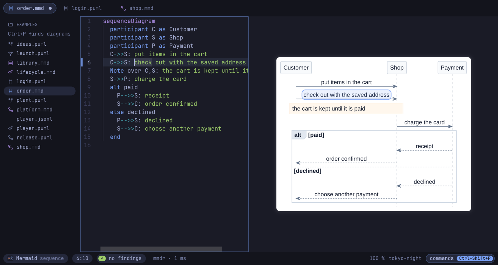

# Omagram

A native PlantUML and Mermaid editor for [Omarchy](https://omarchy.org), written in Rust.
Source in the middle, the live diagram on the right, in the colors of your Omarchy theme
and the font `omarchy font set` picked. Offline, for keyboard, mouse and touchpad, no
browser, no JVM required.



**Status: pre-alpha.** The editor, the preview window and the command line tools work.
Mermaid renders natively, and so do most PlantUML diagrams, with Omagram's own engine:
sequence, activity, state, class, component, use case, deployment, object, timing and Gantt
diagrams, mind maps, WBS, JSON and formulas (`@startlatex`, `@startmath`). The other
PlantUML types (YAML, network diagrams, Salt and more) render through the `plantuml`
package. Lines between states and between boxes curve, as PlantUML and Mermaid draw them;
`skinparam linetype ortho` keeps right angles. See [ROADMAP.md](ROADMAP.md).

**For specifications.** Omagram reads a state diagram, in PlantUML or in Mermaid, as the
state machine it specifies, and checks it while you type: a state no path from the start
reaches, a state nothing leaves, the same event leading from one state to two others with
no guard to choose, a composite state entered with no start inside. Transition labels are
read as UML writes them, `event [guard] / action`. A sequence diagram is checked against
the state machines of its folder: a participant named like a state diagram (`door.puml`,
or `title Door`) must take every message it receives as an event, in the order the
scenario sends them, through `alt`, `opt` and `loop`.

**Play it.** F5 (`p` in the preview window) runs the diagram on screen. A state machine
starts: the rest of the diagram sinks under a veil, the states it is in shine through it
with a soft glow, and the bar below offers what can happen next, numbered 1 to 9; a light
runs along the transition's own route to the next state, regions start side by side, a
choice (or a state with several ways out) waits for you to pick one, and a history goes
back to where its state was left. A scenario unfolds message by message (Space), a light
running along each arrow. Each step lights its line in the source; ← goes back, Home starts
again, Esc stops.

**Hold a trace against it.** `omagram trace run.jsonl` reads what a running system did,
one JSON object per line (`{"object":"Door","event":"open","state":"Opening"}`, with
`time` and other fields as the log has them), and plays it through the state machines of
its folder: an event the object cannot take where it is by then, or a state it cannot be
in, is an error with the time and the states it could be in. Many objects can share one
machine (`"machine":"Door"`). In the editor, *Play a recorded trace* (command menu) plays
it in the diagram, line by line with Space: the bar shows the time and the event, the
states light up as in a play, and where the trace deviates the bar turns red and says why.
[examples/player.jsonl](examples/player.jsonl) is an evening of the media player
([0007](docs/adr/0007-behavior-specifications.md)).

## Install

Build with `cargo build --release -p omagram-app`; the binary is
`target/release/omagram`. AUR packages (`omagram`, `omagram-bin`, `omagram-git`)
are in [packaging/aur](packaging/aur), to be submitted with the first release; they also
install the desktop entry, the icon and the file types, so file managers open `.puml` and
`.mmd` files with Omagram.

Optional: `plantuml` to draw what Omagram's own engine does not draw yet (the other
PlantUML types, and constructs it declines), `wl-clipboard` to copy diagrams, `git` to
compare with commits.

## Editor

```bash
omagram                      # the last session, or an empty PlantUML diagram
omagram flow.puml seq.mmd    # adds a tab per file; a new name is created on the first save
omagram ~/diagrams           # with that folder in the sidebar
```

The project area is the folder as a tree: one level at a time, directories first, then
every file (hidden names and dependency folders stay out). A folder shows at most 1000
entries, folders and diagrams before other files. Ctrl+P still finds every
diagram in that folder. The project, the editor and the diagram are separate areas.
Ctrl+Alt+arrows moves between them (an accent border shows which one). Ctrl+Shift+N
moves the diagram into a window of its own. Super+F fullscreens the whole window, the
same chord Omarchy uses for every other window. Lint findings are underlined while you
type (F8 jumps to the next);
the diagram is drawn again after a short pause. Ctrl+Shift+[ folds the block at the
caret and Ctrl+Shift+] unfolds it (a diagram block such as `alt`/`end`, or a brace
pair). A click on a render error in the status bar jumps to its line; so does
Ctrl+click on a label, box or diamond in the diagram. Lines changed since the last
save are marked beside the line numbers. The language is detected from the text and the
file name unless `--lang` (or the palette) sets it.

| Keys | |
|---|---|
| Ctrl+Shift+P | every command, as a list; type to filter it |
| Ctrl+P | find a file in the folder by a few letters |
| Ctrl+Shift+E | the examples, as tiles; Enter opens a copy, F5 plays it |
| Ctrl+O | open a file, folder or image by path |
| Ctrl+Shift+F, Ctrl+Shift+H | find, and replace, in all tabs (each tab one undo step) |
| Ctrl+S, Ctrl+Shift+S | save (atomic, keeps the line endings), save as |
| Ctrl+Enter | render now |
| Ctrl+Shift+D | compare with another tab or a git commit |
| Ctrl+Shift+N | the diagram in a window of its own |
| Ctrl+Shift+I, Ctrl+Shift+C | format; copy the diagram as PNG |
| Ctrl+N, Ctrl+W, Ctrl+PageDown/PageUp | new tab, close tab, switch tabs |
| Ctrl+Shift+[, Ctrl+Shift+] | fold the block at the caret, unfold it |
| Ctrl+B, Ctrl+Q | project tree on/off, quit |
| Ctrl+Alt+arrows | move between the project, the editor and the diagram |
| Alt+=, Alt+-, Alt+0, Alt+F | zoom the diagram, 100 %, fit |
| Ctrl+F, Ctrl+H, Ctrl+/, Ctrl+D | in the text: find, replace, comment, next occurrence |

The status bar shows the Omagram mark and `Ctrl+Shift+P`; a click opens the command
list. Export asks for a path in that line (Enter writes it, a second Enter replaces a
file that is already there). The palette also opens the Help Omagram folder: diagrams
of the menu, editing, the window and export. The line under its heading, or "Leave Help
Omagram" in the palette, brings the project folder back and closes the help pages.

**Compare.** Ctrl+Shift+D compares the tab (A) with another tab or with the file in a git
commit (`HEAD` and the last 30 commits that changed it) as B: both diagrams side by side,
zoomed and panned together, or B as the source lines that changed from B to A (blank lines
and indentation aside; a click goes to the line). Meanwhile the marks beside the lines show
the difference to B.


**A second monitor.** Ctrl+Shift+N moves the diagram into a window of its own (class
`omagram-preview`): the editor takes the room, the diagram window follows the active tab,
has the preview's keys (`+`/`-`, `0`, `f`), and Ctrl+click there jumps in the editor.
Escape or closing it brings the diagram back.

**Skin packs** (in the palette: plain, spec, presentation, Omarchy colors) put a look
into the source itself, so it stays with the file, exports and copies: `skinparam` lines
after `@startuml`, or an `%%{init}%%` line in Mermaid, marked so that the next pack
replaces it. The Omarchy pack writes the active theme's colors in. **Diagram theme:
follow Omarchy** colors the picture with the active theme without changing the file, and
follows a theme switch. Mermaid's own `%%{init}%%` lines (theme, colors, font) are
honored too.

**Examples.** Ctrl+Shift+E (or *Examples* on an empty page) lays the examples that come
with Omagram out as tiles: a coffee machine's states, a pizza night's scenario, a first
day at work in swimlanes, a washing machine's timing, a bookshop's classes, a garden year
as a mind map, a treehouse as a Gantt chart and more, 24 in PlantUML and Mermaid. Seven
are complex (an elevator, a checkout, an incident in three lanes, a delivery pipeline, a
library system and more) and have a *complex* filter of their own.
Each tile is drawn on the spot by Omagram's engines, in the colors the diagram pane would
show; the *Omarchy colors* switch redraws them all in the theme's. Typing filters (by
title, kind, language, or `complex`), Tab steps through behavior, structure, plans and
data, the arrows move between tiles. Enter
(or a click) opens a copy in a new tab, unsaved, under a free name in the project folder;
F5 (or the *plays* badge) opens it and plays it.

**Images with their source.** Exported PNGs and SVGs carry the diagram source. Dropped on
the window or opened with Ctrl+O, such an image opens as a new, unsaved tab under a name
nothing has yet (`flow-2.mmd` next to `flow.mmd`), so saving never overwrites the
original.

**Session.** The window keeps its session in `~/.local/state/omagram/` (readable by you
only): open tabs with their unsaved text, the folder, the caret. Closing the window loses
nothing; the next start brings it all back. Closing a tab with unsaved changes asks once
in the status bar. A second window works without a session. A file changed on disk is
reloaded when its tab has no unsaved changes.

## Omarchy

Omagram follows theme switches and `omarchy font set` while it runs. Every bundled
theme is checked for legible colors; faint ones (a yellow on white) are deepened just
enough to read.


Templates in [packaging/omarchy](packaging/omarchy) (installed to
`/usr/share/omagram/omarchy` by the AUR package):

- `hyprland.lua`: SUPER+SHIFT+U opens the editor. SUPER+F stays Omarchy's fullscreen
  for the whole window. Window rules for the diagram windows are commented there.
- `omarchy-menu.jsonc`: a "Diagram editor" entry for the Omarchy menu.
- `omagram.toml.tpl`: copy it to `~/.config/omarchy/themed/` to set Omagram's syntax
  and mark colors per theme with Omarchy's placeholders (`{{ accent }}`, `{{ blue }}`,
  `{{ mix background foreground 40% }}`). `omagram theme` shows what it took.

Copies to the clipboard and exports send an Omarchy notification.

Window classes for Hyprland rules: `omagram` (editor), `omagram-preview` (preview
window and the editor's diagram window).

## Preview next to your editor

```bash
omagram preview flow.puml   # a window that renders again on every save
```

Edit in Neovim (or anything else), keep the preview tiled next to it. Errors show in the
status bar while the last good picture stays. Keys: `+`/`-` zoom, `0` 100 %, `f` fit,
`h j k l` pan, `c` copy PNG, `C` copy SVG, `r` render again, `q` quit. Mouse wheel zooms
at the pointer, two-finger scroll and dragging pan, Ctrl + two-finger scroll zooms, double
click fits, Ctrl+click names the source line of what is drawn there.

## Command line

```bash
omagram lint diagrams/*.puml        # syntax, likely typos, specification checks; exit 1 on errors
omagram lint --project specs a.puml # sequences checked against the state machines in specs/
omagram lint --strict --json a.mmd  # warnings fail too; JSON for scripts
omagram trace run.jsonl             # a recorded trace against the state machines next to it; --project, --json
omagram fmt --write diagrams/*.puml # re-indent in place (atomic); --check for CI
omagram outline flow.puml           # structure: participants, groups, lanes, states, …
omagram inspect flow.puml           # language, kind, findings, outline, and whether Omagram draws it
omagram diff door.puml              # what changed in the behavior since the last commit; --rev, or two files
omagram convert door.puml -o door.mmd  # the same machine or scenario in Mermaid (or PlantUML), or why not
omagram render flow.mmd             # flow.svg next to it, with the source inside
omagram render flow.mmd --json      # where the image went, or the error and its line, as JSON
omagram render flow.mmd -o flow.png # PNG (2x), JPEG, PDF, Markdown or ZIP by extension; --copy for the clipboard
omagram extract diagram.png         # the source stored in an exported PNG or SVG
omagram example                     # the examples of the gallery; `example NAME` prints one, --json
omagram theme                       # the palette Omagram reads from your Omarchy theme
```

## AI agents

`omagram mcp` is a Model Context Protocol server over standard input and output: an
agent lints a diagram, holds a trace against the state machines of its project, formats
it, and renders it, getting a PNG back to look at. The tools are the command line's
(`lint`, which also takes a folder, `trace`, `inspect`, `outline`, `diff`, `convert`,
`format`, `render`),
with the same findings and one-based lines. Nothing goes over the network.

```bash
claude mcp add omagram -- omagram mcp   # Claude Code
```

Other clients take the same command in their server list, for example
`{"mcpServers": {"omagram": {"command": "omagram", "args": ["mcp"]}}}`. Relative paths
are read from the folder the client starts the server in.

[examples/gallery](examples/gallery) holds the examples of the gallery (Ctrl+Shift+E).
[examples](examples) holds a few more diagrams to try: a login sequence, ideas as a mind map,
a website launch as a WBS, a release activity with swimlanes, a media player's states
(PlantUML); an order sequence, a shop flow, a web platform in nested subgraphs, a
library's classes, a document's lifecycle (Mermaid). `examples/Help Omagram` describes
the editor itself, including the command menu. The palette command opens a copy of that
folder.

## License

MIT. The editor widget is [scrive](https://github.com/robbym/scrive) (MIT), built from a
copy with small additions in [vendor](vendor). JPEG export uses
[jpeg-encoder](https://github.com/vstroebel/jpeg-encoder), whose DCT is derived from the
Independent JPEG Group's software.
