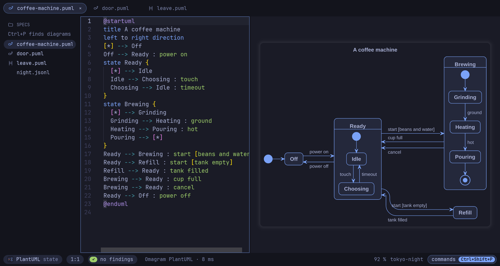
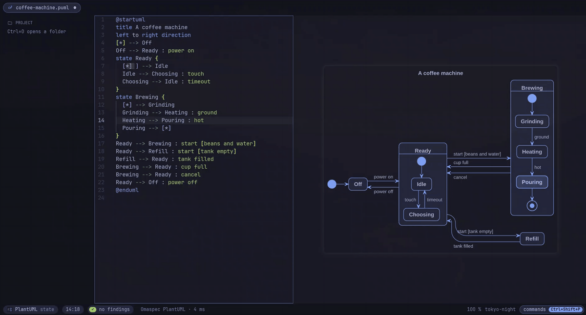
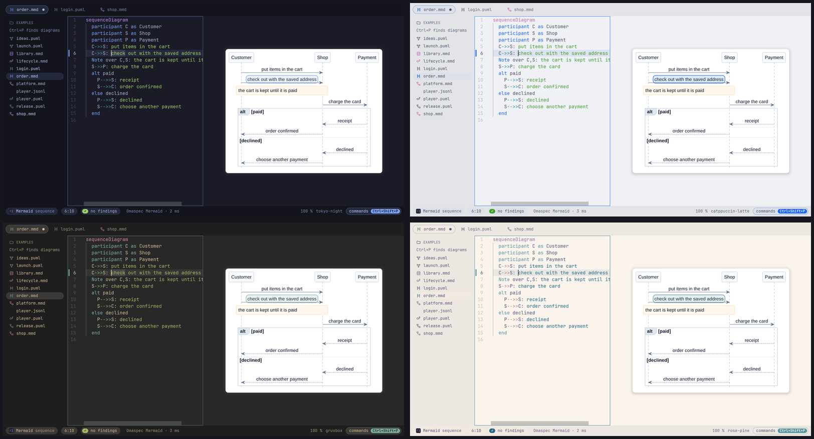
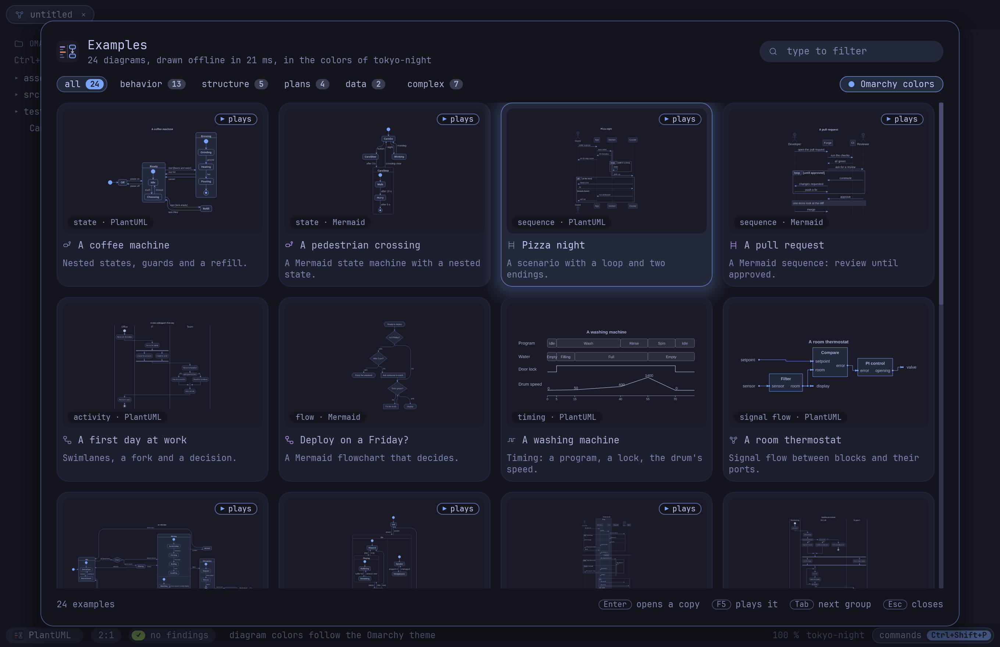

<p align="center">
  
</p>

<h1 align="center">Omaspec</h1>

<p align="center">
  <b>PlantUML and Mermaid, drawn as you type and understood as behavior.</b><br>
  A native diagram editor for <a href="https://omarchy.org">Omarchy</a>, written in Rust.
</p>

<p align="center">
  <a href="https://github.com/enhapu-afk/omaspec/actions/workflows/ci.yml"></a>
  <a href="https://github.com/enhapu-afk/omaspec/releases/latest"></a>
  <a href="LICENSE"></a>
</p>

<p align="center">
  <a href="#install">Install</a> ·
  <a href="docs/guide/README.md">Getting started</a> ·
  <a href="docs/guide/reference.md">Reference</a> ·
  <a href="ROADMAP.md">Roadmap</a>
</p>



The source in the middle, the live diagram on the right, in the colors of your Omarchy
theme and the font `omarchy font set` picked. One binary with its own engines: no Java,
no browser, no network, and it sends nothing anywhere.

## Why Omaspec

### It draws as you type

Omaspec draws with its own engines, in a few milliseconds: PlantUML sequence, activity,
state, class, component, use case, deployment, object, timing and Gantt diagrams, mind
maps, WBS, JSON and formulas, and Mermaid flowcharts, state and sequence diagrams. The
other Mermaid types are drawn by mmdr, a Rust library, in the same process. Lint findings
are underlined while you type, and a Ctrl+click in the diagram jumps to its line in the
source.

### It reads your diagram as behavior

A state diagram is the state machine it specifies, and a sequence diagram is a scenario,
in PlantUML and Mermaid alike. Omaspec checks them while you type: a state no path
reaches, a state nothing leaves, one event leading two ways with no guard to choose. A
scenario is checked against the state machines of its folder: every message must be an
event its receiver can take, in the order the scenario sends them.


### Play it

F5 runs the diagram on screen. The states the machine is in light up, you pick what
happens next, and a light runs along each transition. A scenario unfolds message by
message.



### Hold a recorded trace against it

`omaspec trace run.jsonl` plays what a running system logged through its state machines
and says where it deviated, with the time. The editor plays the trace in the diagram,
line by line, and the bar turns red where the system did what the specification does
not allow.


### It looks like your Omarchy

Omaspec follows `omarchy theme` and `omarchy font set` while it runs, and colors the
diagram with the theme if you like. Every bundled theme is checked for legible colors.



### And more

- **Compare** a diagram with another tab or any git commit, as pictures side by side or
  as changed lines. `omaspec diff` says what changed in the *behavior*: states,
  transitions and messages, not layout.
- **Convert** a state machine or scenario between PlantUML and Mermaid, only when the
  result means the same.
- **Images that remember.** Exported PNGs and SVGs carry their source; drop one on the
  window and it opens as a diagram again.
- **Next to Neovim.** `omaspec preview flow.puml` is a window that renders again on every
  save.
- **For scripts and AI agents.** Every check is on the command line, with JSON output and
  exit codes, and `omaspec mcp` is an MCP server with the same tools.
- **24 examples** to start from, as tiles drawn on the spot (Ctrl+Shift+E).



## Install

On Omarchy (or any Arch Linux), build the package from this repository:

```bash
git clone https://github.com/enhapu-afk/omaspec
cd omaspec/packaging/aur/omaspec-bin   # the release, prebuilt
makepkg -si                            # or in ../omaspec: the release, built from source
```

The packages go to the AUR (`omaspec`, `omaspec-bin`, `omaspec-git`) as soon as it takes
new accounts again; then `yay -S omaspec-bin` will do.

The packages also install the desktop entry, the icon and the file types, so file
managers open `.puml` and `.mmd` files with Omaspec, and the Omarchy templates (a
Hyprland binding, a menu entry, themed colors) under `/usr/share/omaspec/omarchy`.

Elsewhere, take the binary from the [latest release](https://github.com/enhapu-afk/omaspec/releases/latest),
or build it with Rust 1.89 or newer:

```bash
cargo build --release -p omaspec-app   # the binary is target/release/omaspec
```

Optional: `plantuml` for the few PlantUML types Omaspec does not draw itself yet (YAML,
Salt and more), `wl-clipboard` to copy diagrams, `git` to compare with commits.

## Quick start

```bash
omaspec ~/diagrams          # the editor, with that folder in the sidebar
```

1. **Ctrl+Shift+E** opens the examples. Pick *A coffee machine* and press **F5**: it
   plays.
2. **Ctrl+N** opens a new tab. Type a diagram; it is drawn after a short pause.
3. **Ctrl+Shift+P** lists every command, so you never need to remember a key.

The [getting started guide](docs/guide/README.md) walks you through a state machine, a
scenario and a recorded trace in ten minutes. The [reference](docs/guide/reference.md)
has every key and command.

## What's next

- **Lines by hand.** Drag a line in the diagram, or a bend in it, to route it yourself;
  the diagram keeps your route.
- **Diagrams that link.** Click a state and the view zooms into it: inside is the
  activity diagram that says what the state does. A specification you can read from the
  whole system down to a single step.
- **Even cleaner lines.** Fewer crossings and detours, lines that keep clear of frames and
  labels, closer to what Graphviz draws.

More in the [roadmap](ROADMAP.md#next). Ideas and wishes are welcome as
[issues](https://github.com/enhapu-afk/omaspec/issues).

## Status

Omaspec is young: well tested (unit and golden tests, a comparison with the Java
PlantUML, fuzzing), but little used outside its tests so far, so you will find rough
edges. Issues, and diagrams it draws wrong, are very welcome;
[CONTRIBUTING.md](CONTRIBUTING.md) says how to report them and how to build and test. The
[roadmap](ROADMAP.md) has the plan, [docs/adr](docs/adr) the decisions.

## License

MIT. The editor widget is [scrive](https://github.com/robbym/scrive) (MIT), built from a
copy with small additions in [vendor](vendor). JPEG export uses
[jpeg-encoder](https://github.com/vstroebel/jpeg-encoder), whose DCT is derived from the
Independent JPEG Group's software.
