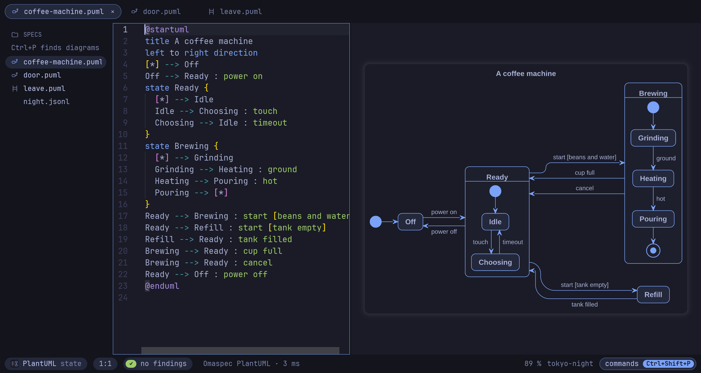
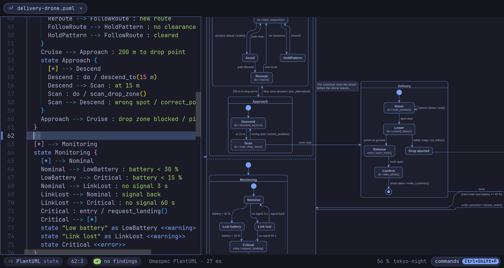

<!-- The release announcement for r/omarchy and the Omarchy community. Before
posting: the version in the title, and the install section once the AUR takes
new accounts again (then it is one line: yay -S omaspec-bin). -->

# Omaspec 0.9.5: a PlantUML and Mermaid editor for Omarchy that understands behavior

Omaspec is a native diagram editor for Omarchy: the source next to the live diagram, in
your Omarchy theme and font. It is pure Rust, one binary that draws with its own
engines: no Java, no browser, no network, and it sends nothing anywhere.



## What PlantUML and Mermaid cannot do

Omaspec reads a state diagram as the state machine it specifies, and a sequence
diagram as a scenario, in PlantUML and Mermaid alike:

- **Checks while you type.** A state no path reaches, a state nothing leaves, one event
  leading two ways with no guard to choose. A sequence diagram is checked against the
  state machines of its project: every message must be an event its receiver can take,
  in the order the scenario sends them.
- **Play it.** F5 runs the diagram on screen: the states the machine is in light up, you
  pick what happens next, a light runs along each transition or message.
  [See it play](https://raw.githubusercontent.com/enhapu-afk/omaspec/main/docs/images/play.gif).
- **Hold a recorded trace against it.** `omaspec trace run.jsonl` plays what a running
  system logged through its state machines and says where it deviated, with the time.
  The editor plays the trace in the diagram, line by line.
- **What changed in the behavior.** `omaspec diff` compares two versions, or a file
  with its last commit, by states, transitions and messages, not by lines; layout and
  colors do not count. `omaspec render --format text` writes a diagram as its behavior,
  one fact a line, for an agent or a terminal that shows no pictures.
- **Write it in the other language.** `omaspec convert` turns a PlantUML machine or
  scenario into Mermaid and back, and only when the result means the same.
- **For AI agents.** `omaspec mcp` is an MCP server with the command line's tools:
  lint, trace, diff, convert, format, render and more.

## New in 0.9: a layout you can steer

- **Lines by hand.** Hold Alt and drag a line of a state, class, component or flowchart
  diagram, or a bend in it, to route it yourself. The shape is kept in the file as a
  comment every other tool ignores, stretches with the diagram when it changes, and
  curves as wide as the layout's own lines.
- **Boxes held in place.** Drag a box to where it should stay, beside another; the layout
  keeps it there, in the file the same way.
- **Fold and focus.** A composite state, a package or a subgraph folds to its box with a
  click; the boxes glide to their new places and the lines glide with them. Shift and a
  click puts a box in focus: a veil over the rest, the box, its neighbors and their lines
  come through.
- **Cleaner lines.** A line through several ranks steps aside once instead of in every
  gap, labels keep clear of the curves, and lines that end at one box share a trunk,
  as Graphviz's `concentrate` does.
- **Skins with color.** The sketch pack draws by hand in pastel colors on warm paper, the
  new vivid pack colors by kind (blue boxes, violet interfaces, pink decisions, green
  stores, amber actors, yellow notes), presentation draws in one blue, plain in black on
  white. A pack is a few lines in the file, so the look travels with it.
- **Menus for the mouse.** The right mouse button opens a context menu over the diagram
  and the editor, a tap on Alt shows a menu bar, and a small toolbar sits over the
  diagram; every entry shows its shortcut.
- **Smoother to use.** Ctrl+click in the diagram puts the caret on the word, the light
  on the name under the caret travels to its next place, and a play's light runs along
  each arrow as one stroke.
- **A calmer map (0.9.1).** On a project's map the arrows run around the cards, and
  those into one diagram share a line. A click on a card zooms into its diagram as one
  sharp picture that grows, and back; a diagram changed in its tab shows that way on
  the map before it is saved.

## New in 0.9.2 and 0.9.3

- **The map is made, not written.** A project's map comes from its diagrams: a tile for
  each, an arrow where a state of one opens another, laid out by those arrows.
  `omaspec new DIR` starts a project, `omaspec render DIR/omaspec-project.toml` draws
  its map; nothing has to be kept in step by hand.
- **A picture that moves.** `omaspec play door.puml -o door.gif --events open,close`
  writes a play as a GIF, `--fold Brewing` a container folding and unfolding, and
  `--dive Orders` on a project the zoom from its map into a diagram and back: drawn as
  the window draws them, for a pull request or a talk.
- **Small things for the layout.** A color for one box and a label on the other side of
  its line, both from the caret and kept in the source; the skin the menu points at
  shows in the diagram before it is chosen; a folded container says what it holds.
- **What changed, as a glide.** Compare shows the change since another version as the
  boxes and lines gliding from there to here.
- **Cleaner lines.** A line through several ranks changes sides as a whole where that
  crosses less: on 300 random graphs 28 % fewer crossings.
- **Two small fixes (0.9.3).** A Mermaid sequence diagram draws the title of its front
  matter, and a component's name keeps clear of its icon.

## New in 0.9.5

- **Views from the behavior.** A state machine as a table, states down and events across;
  what changed since the last commit drawn over its new version; what recorded traces
  covered, and missed, drawn over the machine; a trace as a timing diagram.
- **Architectures, elegant or playful.** C4-PlantUML and ArchiMate drawn by Omaspec,
  Open Iconic icons and sprites in the color of the words, cards with lists and emoji,
  a line within a rank, and a box placed by a word: `D below C`, `level with`.
- **More PlantUML without Java.** JSON and YAML (as a tree or nested, branches that
  fold), network diagrams, Salt wireframes, EBNF and regular expressions as railroads,
  and Ditaa.
- **More Mermaid on Omaspec's own drawers.** Requirement diagrams, ZenUML, and the
  packet, radar, treemap, sankey, XY and quadrant charts.
- **Fast when dense.** A flowchart of 150 boxes and 476 lines is laid out in under half a
  second, where it took close to a minute; CI holds it there.
- **An outline beside the source**, and an example from the gallery put in where the caret
  is.

## New in 0.9.4

- **Runs outside Arch.** The release binary starts on glibc 2.35 and newer (Ubuntu 22.04,
  Debian 12); the one of 0.9.3 asked for Arch's. There is one for ARM (aarch64) too.
- **An editor that helps.** The source colored by what a word is, what could be written
  offered as you type, a finding with its fix, find in the file, and the menus a mouse
  expects.
- **More of both languages.** Mermaid's git graph and kanban board drawn by Omaspec;
  `<style>`, stereotypes and shadows in PlantUML's structure diagrams, mind maps and WBS.
- **Trees that fold.** A branch of a mind map or a WBS folds into its box and glides out
  of it.

## The editor

- Lint findings while you type; outline; Ctrl+click in the diagram jumps to the word.
- Compare a diagram with another tab or with any git commit, as pictures or changed lines;
  a project's history by what changed in the behavior.
- The diagram in its own window for a second monitor; a preview window for Neovim users.
- Follows `omarchy theme` and `omarchy font set` live; a Hyprland binding, a menu entry
  and themed colors included.
- Exports SVG, PNG and PDF with the source inside, so an image opens as a diagram again;
  a whole project as linked SVGs and a ZIP anyone can open in a browser.
- 28 examples to start from (Ctrl+Shift+E), and every command in a palette
  (Ctrl+Shift+P).

## Drawing

Omaspec draws most diagrams with its own engines, in a few milliseconds: PlantUML
sequence, activity, state, class, component, use case, deployment, object, timing and
Gantt diagrams, mind maps, WBS, JSON, YAML, network diagrams, Salt wireframes, EBNF and regex railroads, Ditaa drawings and formulas, and Mermaid flowcharts, state and
sequence diagrams (state diagrams of both languages by the same engine). The other
Mermaid types are drawn by mmdr, a Rust library, in the same
process. A few PlantUML types (Graphviz and tree diagrams) it does not draw yet and says so; if you
install the optional `plantuml` package (Java), Omaspec hands just those to it,
confined with Landlock. Omaspec reads state and sequence diagrams as PlantUML 1.2026.8
does; a test holds the two readings against each other.

Large diagrams too: a delivery drone with 45 states up to four levels deep, two regions
side by side and 72 transitions, drawn in about 30 ms
([its source](https://github.com/enhapu-afk/omaspec/blob/main/examples/drone/delivery-drone.puml)).



## Install

Omaspec is not in the AUR yet, because the AUR takes no new accounts at the moment.
Until it does, build the package from the repository:

```bash
git clone https://github.com/enhapu-afk/omaspec
cd omaspec/packaging/aur/omaspec-bin
makepkg -si
```

This installs the release binary with the desktop entry, the icon and the file types,
so file managers open `.puml` and `.mmd` files with Omaspec. On other distributions, take
the binary from the [release](https://github.com/enhapu-afk/omaspec/releases/latest).

The [getting started guide](https://github.com/enhapu-afk/omaspec/blob/main/docs/guide/README.md)
walks you through a state machine, a scenario and a recorded trace in ten minutes.

## What's next

- **Windows.** The engine and the binary already build for it; the clipboard, the font
  and the palette without Omarchy come next.
- **Even cleaner lines.** Labels of lines between closed containers, fewer crossings where
  frames set the order.
- **The AUR**, as soon as it takes new accounts.

## Status

Omaspec is young: well tested (unit and golden tests, a comparison with the Java
PlantUML, fuzzing, a measure of how clean the lines are), but little used outside its
tests so far, so you will find rough edges. Issues, diagrams it draws wrong, and wishes
are very welcome: https://github.com/enhapu-afk/omaspec/issues
