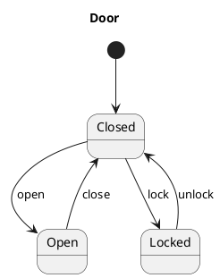
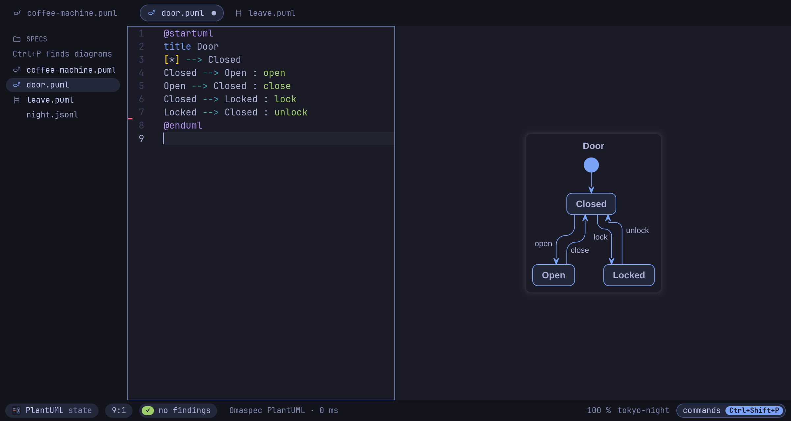
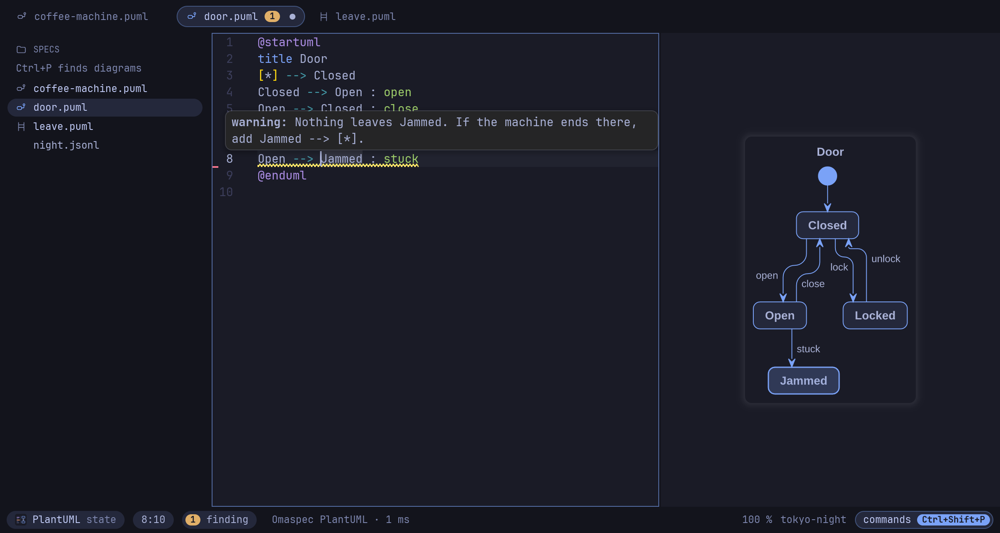
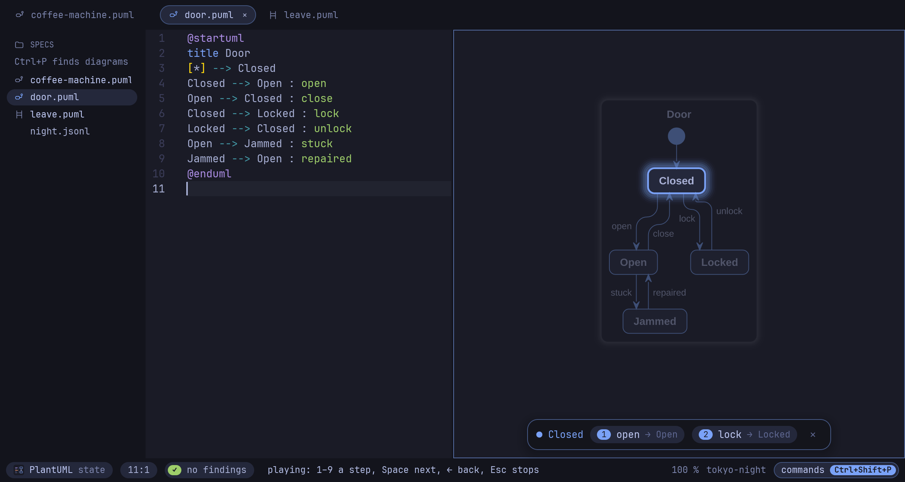
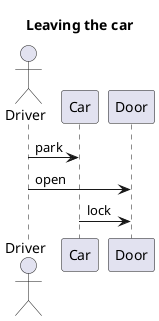
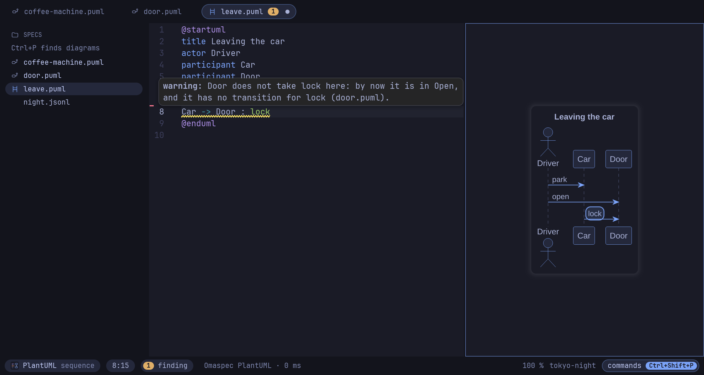
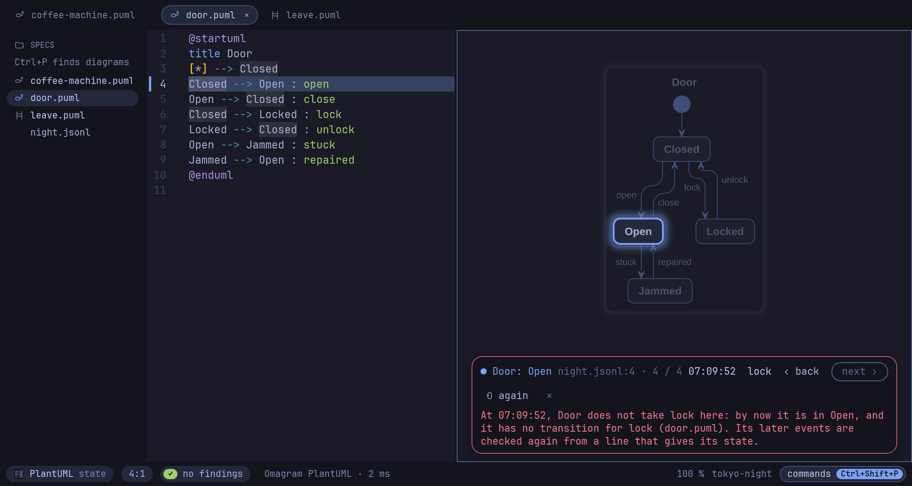

# Getting started

Ten minutes from an empty folder to a state machine that is checked, played and held
against what a real system did. You write a door: it opens, closes, locks and sometimes
jams. The finished files are in [examples/door](../../examples/door).

Omaspec reads PlantUML and Mermaid alike; this guide uses PlantUML. Every key here is
also in the command list (**Ctrl+Shift+P**), so you never need to remember one. Every
key and command is in the [reference](reference.md).

1. [Install](#1-install)
2. [Draw a state machine](#2-draw-a-state-machine)
3. [Let Omaspec check it](#3-let-omaspec-check-it)
4. [Play it](#4-play-it)
5. [Write a scenario against it](#5-write-a-scenario-against-it)
6. [Hold a recorded trace against it](#6-hold-a-recorded-trace-against-it)
7. [Share it](#7-share-it)
8. [Where next](#8-where-next)

## 1. Install

On Omarchy (or any Arch Linux), build the prebuilt release's package:

```bash
git clone https://github.com/enhapu-afk/omaspec
cd omaspec/packaging/aur/omaspec-bin && makepkg -si
```

Other ways are in the [README](../../README.md#install). Check that it runs:

```bash
omaspec theme   # the palette Omaspec reads from your Omarchy theme
```

## 2. Draw a state machine

Make a folder and open the editor on it:

```bash
mkdir -p ~/specs && omaspec ~/specs
```

The folder is in the sidebar on the left. Press **Ctrl+N** for a new tab, type the door,
and save it as `door.puml` with **Ctrl+S**:



The diagram appears on the right a moment after you stop typing. A **Ctrl+click** on a
state or a label in the diagram jumps to its line.



The diagram here is in the colors of the Omarchy theme. To get that, run *Diagram theme:
follow Omarchy* from the command list; your file stays as it is.

## 3. Let Omaspec check it

Omaspec reads a state diagram as the state machine it specifies and checks it while you
type. Add a door that jams:

```plantuml
Open --> Jammed : stuck
```

The line gets a dotted underline, and the status bar counts one finding. Rest the pointer
on it to read it, or press **F8** to jump to the next finding:



A jammed door that stays jammed forever is not what you meant, so give it a way out:

```plantuml
Jammed --> Open : repaired
```

The finding is gone. Omaspec also finds a state no path from the start reaches, one event
leading from one state to two others with no guard to choose (`open [unlocked]` is an
event with a guard), and a composite state entered with no start inside.

The same checks run on the command line, for scripts and CI:

```console
$ omaspec lint door.puml
door.puml:8: warning: Nothing leaves Jammed. If the machine ends there, add Jammed --> [*].
```

Warnings leave the exit code at 0; `--strict` makes them fail too, and `--json` is for
scripts.

## 4. Play it

Press **F5**. The machine starts: the rest of the diagram sinks under a veil, the state
it is in shines through, and the bar below lists what can happen next, numbered.



Press a number (or click an option) and a light runs along the transition to the next
state. **←** goes back a step, **Home** starts again, **Esc** stops. While it plays, the
line of each step lights up in the source.

Bigger machines play the same way: try *A coffee machine* from the examples
(**Ctrl+Shift+E**), with states inside states.

## 5. Write a scenario against it

A sequence diagram is a scenario. Omaspec checks it against the state machines in its
folder: a participant named like a machine (here `Door`, from `title Door` or from the
file name `door.puml`) must take every message it receives as an event, in this order.

Save this as `leave.puml`:



The car locks the door while it is still open:



```console
$ omaspec lint leave.puml
leave.puml:8: warning: Door does not take lock here: by now it is in Open, and it has no transition for lock (door.puml).
```

Add the step the scenario forgot, before the car locks the door:

```plantuml
Driver -> Door : close
```

Press **F5** here too: the scenario unfolds message by message with **Space**, a light
running along each arrow.

## 6. Hold a recorded trace against it

A running system can log what happened, one JSON object per line: the object, the event,
and, if the log knows it, the state it ended up in and the time. Save this as
`night.jsonl` next to the door:

```json
{"time":"22:10:04","object":"Door","event":"lock","state":"Locked"}
{"time":"06:58:40","object":"Door","event":"unlock","state":"Closed"}
{"time":"07:02:11","object":"Door","event":"open","state":"Open"}
{"time":"07:09:52","object":"Door","event":"lock"}
```

`omaspec trace` plays it through the state machines of its folder:

```console
$ omaspec trace night.jsonl
night.jsonl:4: error: At 07:09:52, Door does not take lock here: by now it is in Open, and it has no transition for lock (door.puml). Its later events are checked again from a line that gives its state.
```

It exits with 1, so a test run can fail on it. In the editor, open `door.puml` and run
*Play a recorded trace* from the command list: the trace plays in the diagram, line by
line with **Space**, and the bar turns red where the door did what the machine does not
allow.



Many objects can share one machine: give each line an `"object"` of its own and
`"machine":"Door"`.

## 7. Share it

**Export.** Type *export* in the command list and pick SVG, PNG, JPEG, PDF or Markdown;
the status bar asks for the path. **Ctrl+Shift+C** copies the diagram as a PNG. On the
command line, the extension picks the format:

```console
$ omaspec render door.puml -o door.png
door.puml → door.png (Omaspec PlantUML, 2.9 ms)
```

The image carries its source. Drop it on the Omaspec window (or open it with **Ctrl+O**)
and it opens as a diagram again; `omaspec extract door.png` prints the source.

**In Mermaid.** `omaspec convert` writes the same machine in the other language, and
refuses when the result would not mean the same:

```console
$ omaspec convert door.puml -o door.mmd
door.puml → door.mmd
```

**What changed.** With the door committed to git, let `repaired` lead to `Closed`
instead, and ask what changed in the *behavior*, not in the lines:

```console
$ omaspec diff door.puml
door.puml:9: changed: On repaired, Jammed now goes to Closed instead of Open.
```

Layout and colors do not count. In the editor, **Ctrl+Shift+D** compares the tab with
another tab or a recent commit, side by side.

## 8. Where next

- **The examples.** **Ctrl+Shift+E** shows 24 of them as tiles, from a pizza night to an
  elevator; **F5** on a tile plays it.
- **Next to Neovim.** `omaspec preview door.puml` opens a window that draws the file again
  on every save. Tile it next to your editor.
- **AI agents.** `claude mcp add omaspec -- omaspec mcp` gives Claude Code (or any MCP
  client) the same checks: lint, trace, diff, convert, render.
- **Everything else** is in the [reference](reference.md): keys, the command line, skin
  packs, the Omarchy integration.
