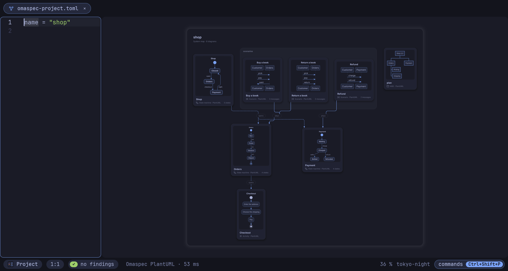
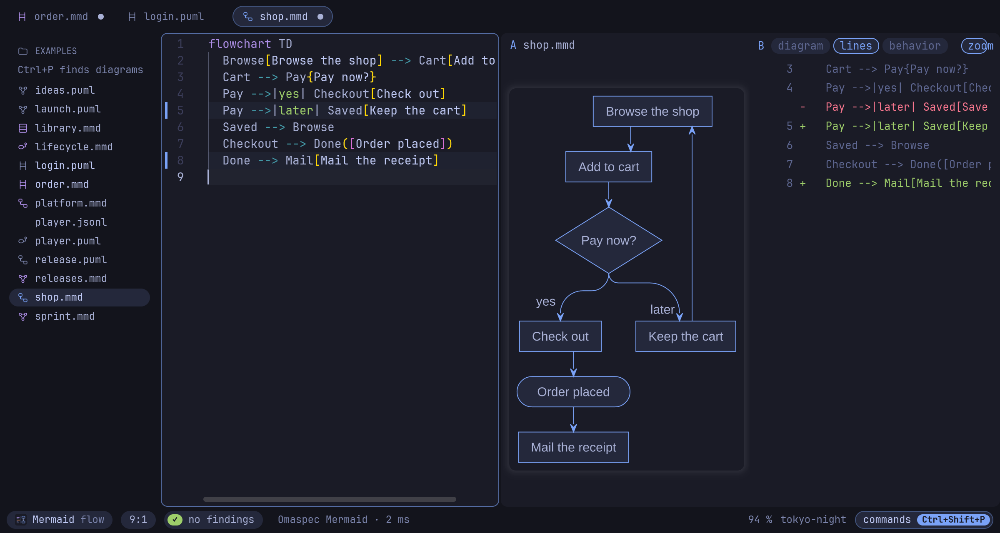
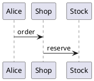
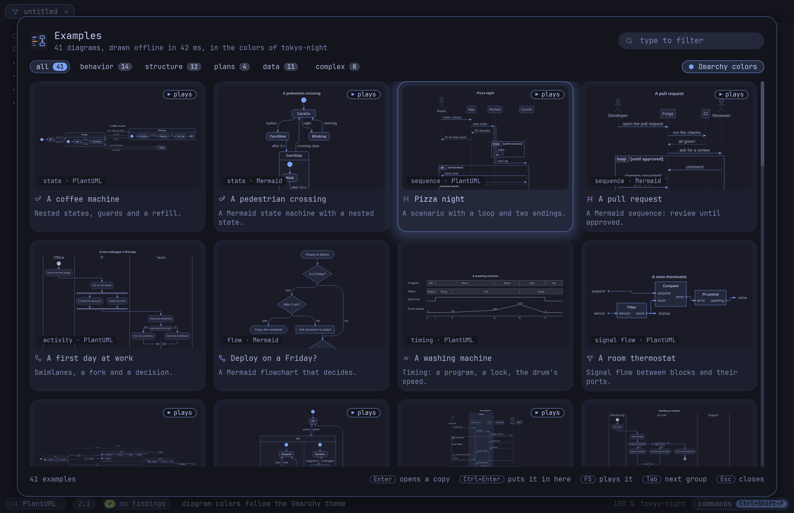
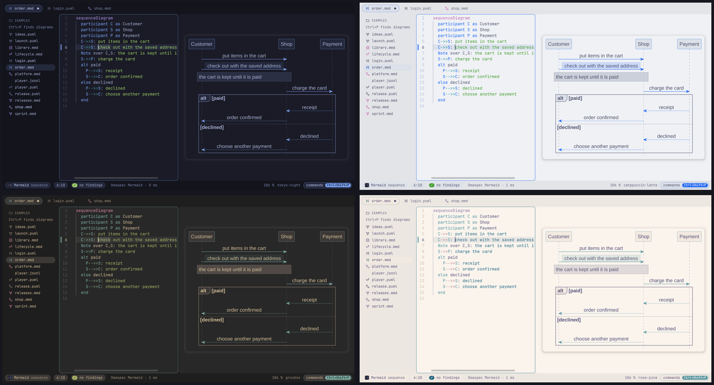

# Reference

Everything Omaspec does, to look up. New here? Start with the
[getting started guide](README.md).

- [Editor](#editor): [keys](#keys), [project and tabs](#project-and-tabs),
  [diagrams that link](#diagrams-that-link), [compare](#compare), [a second monitor](#a-second-monitor), [skin packs](#skin-packs),
  [fold and focus](#fold-and-focus), [examples](#examples), [images with their source](#images-with-their-source),
  [session](#session)
- [Preview next to your editor](#preview-next-to-your-editor)
- [Specifications](#specifications)
- [Command line](#command-line)
- [AI agents](#ai-agents)
- [Omarchy](#omarchy)
- [What Omaspec draws](#what-omaspec-draws)

## Editor

```bash
omaspec                      # the last session, or an empty PlantUML diagram
omaspec flow.puml seq.mmd    # adds a tab per file; a new name is created on the first save
omaspec ~/diagrams           # with that folder in the sidebar
```

### Keys

| Keys | |
|---|---|
| Ctrl+Shift+P | every command, as a list; type to filter it |
| Ctrl+P | find a file in the folder by a few letters |
| Ctrl+Shift+E | the examples, as tiles; Enter opens a copy, F5 plays it, Ctrl+Enter puts it in at the caret |
| F5 | play the diagram (a state machine, a scenario or a git graph) |
| Shift+F5 | present the diagram: full screen in its own window, played, the speaker's notes in this one; Esc ends |
| Ctrl+O, Ctrl+Shift+O | open a diagram, document or image; open a folder in the sidebar (in the desktop's own dialog) |
| Ctrl+F in the source | find in this file |
| Ctrl+Shift+F | find in every file of the project, the open tabs first; a hit opens its file |
| Ctrl+Shift+H | replace in all tabs (each tab one undo step) |
| Ctrl+F in the diagram | find a state, a message or any label; it lights up and comes into sight |
| F2 | rename the diagram, state or event at the caret at every use in the project |
| Project › Where it is used | every use of the name at the caret, each a line to go to |
| Project › Check the project | lint every saved diagram of the project and list the findings |
| Project › History of the diagram | the commits that changed the file and how much each changed in its behavior; Enter compares with one |
| File › Open recent | the files opened last, the newest first |
| Ctrl+S, Ctrl+Shift+S | save (atomic, keeps the line endings), save as (in the desktop's own dialog) |
| Ctrl+Enter | render now |
| F8 | jump to the next lint finding |
| Ctrl+Shift+D | compare with another tab, a git commit, or the project since one |
| Ctrl+Shift+N | the diagram in a window of its own |
| Ctrl+Shift+I, Ctrl+Shift+C | format; copy the diagram as PNG |
| Ctrl+Space | the list of what could be written at the caret |
| Ctrl+. | make the fix of the finding on the caret's line |
| Ctrl+N, Ctrl+W, Ctrl+PageDown/PageUp | new tab, close tab, switch tabs |
| Ctrl+Shift+[, Ctrl+Shift+] | fold the block at the caret, unfold it |
| Ctrl+B, Ctrl+Q | project tree on/off, quit |
| Ctrl+Alt+arrows | move between the project, the editor and the diagram |
| Alt+=, Alt+-, Alt+0, Alt+F | zoom the diagram, 100 %, fit |
| click, Alt+Left | into a linked state or a tile of a map, and back out |
| Shift+click | focus on a box and its neighbors; on paper, end it |
| right click | a menu of the actions for what is under the pointer: in the diagram the box or the line there, in the text the caret; the arrows and Enter work in it |
| Alt, F10 | a tap on Alt shows or hides the menu bar (File, Edit, View, Diagram, Project, Help, every entry with its keys) and, with it, a toolbar over the diagram (View › Toolbar); F10 opens File; Left and Right walk the menus |
| Ctrl+F, Ctrl+H, Ctrl+/, Ctrl+D | in the text: find, replace, comment, next occurrence |
| Super+F | fullscreen (Omarchy's chord for every window) |

The status bar shows the Omaspec mark and `Ctrl+Shift+P`; a click opens the command
list. To export, right-click the diagram and pick *Export as ›* and a format (SVG, PNG,
JPEG, PDF, Markdown, ZIP, Presentation, Animation), or take it from File › Export as. The desktop's own save
dialog opens (Omarchy's, through xdg-desktop-portal): the folder, the name, and beside
them *Colors*: as the diagram shows, in the file's own colors, plain, light, dark, or
for an SVG auto. A color the file sets itself (`box #LightBlue`, `|#AntiqueWhite|Lane|`,
Mermaid's `rect rgb(…)` or `style`) stays in a look, unless the words on it would not
read on the look's paper: in a dark look a light box becomes a dark one of its hue, and
dark words of the file's light ones. It asks before it replaces a file. Where no such dialog answers, the
status line asks for the path instead (Enter writes it, a second Enter replaces a file
that is already there; Tab takes the next look, a click takes one). The image keeps
the file's own source whatever the look.

*Animation* writes a container folding to its box and unfolding again as a picture
that moves, as `omaspec play --fold` does: the dialog asks beside the name which
container (*Fold*), and the name's ending says what is written: `.webp` (full color,
the smallest of the two without loss), `.png` (an animated PNG) or `.gif` (256 colors,
about half the size), or `.html`: a page that plays the fold in vectors, sharp at any
size and a fraction of the others' size, by itself or step by step with → and ←. It is drawn in the background from the text in the tab, saved or
not, and the status bar says when it is written; Omaspec waits for it before it quits.

*Presentation* writes one HTML page that plays the diagram as the pane does, in any
browser and offline: it holds the picture, the play and a small script, and fetches
nothing ([ADR 0031](../adr/0031-a-presentation-as-one-page.md)). A scenario steps message
by message, the one played lit, the ones to come veiled; a state machine plays by its
options, which stand under it. →, ↓, Space, PageDown, Enter or a click go on (a
presenter's remote sends these), ←, ↑, PageUp or Backspace go back, Home starts again,
1 to 9 take an option, F shows the page full screen. `#3` after the page's address opens
a scenario at its third message. The page keeps the diagram's source as an SVG does:
`omaspec extract talk.html` gives it back.

### Project and tabs

The project area is the folder as a tree: one level at a time, directories first, then
every file (hidden names and dependency folders stay out). A folder shows at most 1000
entries, folders and diagrams before other files. Ctrl+P still finds every diagram in
that folder. The project, the editor and the diagram are separate areas; Ctrl+Alt+arrows
moves between them, and an accent border shows which one has the keys.

Lint findings are underlined while you type (F8 jumps to the next); the diagram is drawn
again after a short pause. A PlantUML line Omaspec's own engine does not draw yet is an
*info*: the Java PlantUML draws that diagram where it is installed, and nothing does where
it is not, so `omaspec lint` and `check` name the line before the diagram goes there. A
line PlantUML refuses too is an *error*, said as what it is: an EBNF rule named `header`
is the picture's header to PlantUML. A line no diagram type knows says so, rather than
what a sequence diagram lacks, and an empty file is empty. A Mermaid error names the line
it is about, not front matter or a `%% skin:` line above it. A click on a render error in the status bar jumps to its line;
so does Ctrl+click on a label, box, diamond or line in the diagram. Lines changed since the last
save are marked beside the line numbers. The language is detected from the text and the
file name unless `--lang` (or the palette) sets it.

A folder with `omaspec-project.toml` is a project: a diagram anywhere below it is
checked against the state machines of the whole project, its `!include`s may reach into
all of it, and it is the same project whether the diagram came from the sidebar, from
Ctrl+O or from the command line. *New project* in the palette asks for PlantUML or
Mermaid, with git or without, then for the folder in the desktop's own dialog; it writes the project file and a
first state machine named after the project, shows the folder and opens the project's
map. A folder that is there keeps its files. Saving under a name, opening and an export
ask in the desktop's dialog (xdg-desktop-portal, which Omarchy has); where none answers,
the bottom line asks for the path. The file names the project, which heads the
sidebar:

```toml
name = "shop"
```

### A look the project pins

A `[look]` table in `omaspec-project.toml` is what every diagram of the project is
drawn in: in the pane (over the theme's colors), by `render`, the MCP server, `export`
and CI alike. The file and the source stored in an image stay as written.

```toml
[look]
pack = "light"        # plain, spec, presentation, sketch, vivid, light, dark, or auto (light, and dark under a dark scheme)
accent = "#d73a49"    # with light or dark: background, surface, text, accent, muted, note
font = "Lato"         # skinparam defaultFontName, Mermaid's fontFamily; Inter without it
```

A line that does not hold is named. `omarchy` is refused there, as it differs from
machine to machine; `render --look` still takes it, and `--look file` the file's own
colors. A diagram is set in Inter, which ships with Omaspec, unless it names another
font: a picture is the same on every machine, and an exported SVG or presentation
carries the cuts of Inter it uses (16 KB each), so a browser without Inter shows it as
drawn. With a font of your own, an SVG is still laid out the same everywhere (text is
measured on built-in metrics), and a PNG depends on the fonts installed. The layout keeps improving, so an update
may draw a project otherwise: `omaspec render --check .` draws every diagram and holds it
against the SVG beside it, writing nothing, and names what changed: the diagram changed
since its SVG was drawn, or the same diagram drawn differently (its size, words new or
gone, parts moved, parts in other colors). It exits 1 then, for CI; `omaspec render .`
draws them again, to commit.

### Diagrams that link

The diagrams of a project link by name ([ADR 0018](../adr/0018-diagrams-that-link.md)): a
state named `Checkout` links to the diagram called Checkout (by the name after
`@start…`, its title or its file name, letters and digits only, case aside), and carries
a mark of two small squares. A click on it glides into the state and opens that diagram;
a trail over the diagram names the way, `shop › Orders › Checkout`. A click on one of its
names, or Alt+Left, zooms back out. A drag still pans and Ctrl+click still jumps to the
source.

A project's map is made from its diagrams, and written nowhere
([ADR 0026](../adr/0026-the-map-is-made.md)): `omaspec-project.toml` opened in the editor
shows it beside the file. Each diagram file of the project is a tile with that diagram's
picture, drawn by Omaspec's engines in the map's colors, sharp at any zoom; none has to
be listed, and a new file is on the map as soon as it is there. An arrow joins two tiles
where a scenario *plays* against a state machine, a state *opens* the diagram of its
name, or a diagram *includes* a file, and the map is laid out by these arrows: a diagram
stands above the one it leads to. Arrows that arrive alike at one tile meet in their
words and share one head; more than four tiles that lead to the same diagrams stand in a
block with one line. What no arrow joins stands beside one another, the diagrams no arrow
reaches in a block. A folder is a frame around its diagrams; in a project
of more than 36 diagrams a folder is a tile that shows how much it holds, a small box for
each diagram, and a click on it opens the folder's map in the same tab, the trail naming
the way back. A large map shows its cards first, each with its diagram's name and kind,
and the pictures once the tiles are large enough to read. A click on a tile zooms into
its diagram. A diagram open in a tab shows on the map as the tab holds it, saved or not.
A mind map and a WBS are diagrams like any other: they draw as PlantUML and Mermaid draw
them, and on the map each is one tile. `omaspec render DIR/omaspec-project.toml` draws
the map (`omaspec render DIR` writes it as `omaspec-project.svg` beside the diagrams'
SVGs, and `render --check` holds it against the project); the preview window shows it for
the project's file. Ctrl+click on a tile opens its diagram too: a map has no source to
jump to.



The palette also opens the *Help Omaspec* folder: diagrams of the menu, editing, the
window and export. The line under its heading, or *Leave Help Omaspec* in the palette,
brings the project folder back and closes the help pages.

### Compare

Ctrl+Shift+D compares the tab (A) with another tab or with the file in a git commit
(`HEAD` and the last 30 commits that changed it) as B: both diagrams side by side, zoomed
and panned together, or B as the source lines that changed from B to A (blank lines and
indentation aside; a click goes to the line). Meanwhile the marks beside the lines show
the difference to B. *Compare: glide from B to A* in the palette shows the change as a
glide in A's pane: B stands as it was, then its boxes and lines glide to their places in
A, what came fades in and what went fades out. What changed glows a moment, in the colors
`omaspec diff -o` marks a machine in: a box that went turns red as it fades, and once A
stands a box that came glows green and one that changed its size or its color amber.

The same list offers *the project since* `HEAD`, its five newest tags and the commits that
changed it: what changed in the behavior of every diagram of the project since then, the
open tabs as they are, as `omaspec diff DIR --rev` tells it. Typing filters the changes by
their words and their files; Enter opens the file where it changed, next to the version
of that commit (a removed diagram only says so). What is gone is named on its line then,
`door.puml@HEAD:6`.



### A second monitor

Ctrl+Shift+N moves the diagram into a window of its own (class `omaspec-preview`): the
editor takes the room, the diagram window follows the active tab, has the preview's keys
(`+`/`-`, `0`, `f`), and Ctrl+click there jumps in the editor. Escape or closing it
brings the diagram back.

### Presenting

Shift+F5 (*Present the diagram* in the Diagram menu) shows the diagram full screen in a
window of its own and plays it, and the editor's window becomes the speaker's: the time
since the start, where the play is (a scenario's message, a machine's state with its
options and the digit for each), the notes of the step, the line they stand above, and
for a scenario the notes of the next message. The notes are the comments written right
above the step's line, up to a blank line; before the first step, those that open the
diagram after its `@start…`:



The keys are those of a presentation page and of a presenter's remote, in both windows:
→, ↓, Space, Page Down and Enter go on, ←, ↑, Page Up and Backspace go back, Home starts
again, 1 to 9 take a machine's option, F switches the diagram's window between full
screen and a window, and Escape ends the presentation as it began: the play stops, and
the diagram goes back beside the source, or keeps its own window if it had one. With two
screens, move the diagram's window (class `omaspec-preview`) to the one the room looks
at; a Hyprland rule can put it there.

### Skin packs

Skin packs (in the palette: plain, spec, presentation, Omarchy colors, sketch, vivid)
put a look into the source itself, so it stays with the file, exports and copies:
`skinparam` lines after `@startuml`, or an `%%{init}%%` line in Mermaid, marked so that
the next pack replaces it. Plain draws black lines and frames on white and fills nothing;
spec draws in black and white, strict UML, in a serif. Presentation draws
larger, with round corners, in one blue on white. Vivid has a palette by kind: blue boxes,
violet interfaces, pink choices, green databases and queues, amber actors and
participants, yellow notes, slate lines. The Omarchy pack writes the active theme's
colors in. In the menu bar (Edit › Skin) the pane shows the diagram in the pack the
pointer or the arrow keys are on, before it is chosen; the source stays as it is until
Enter or a click.

In a Mermaid flowchart the packs color the shapes by kind too: decisions, terminals
(stadiums and circles) and cylinders apart from the boxes, which Mermaid itself does not.

The sketch pack draws the diagram by hand, in pastel colors on warm paper (light blue
boxes, orange actors, rose decisions, green stores, yellow notes, dark ink): `skinparam handwritten true` in PlantUML,
`look: handDrawn` in Mermaid (in `%%{init}%%`, or in the front matter's `config`), the
way both languages already ask for it. Every line, border and fill is drawn by hand, a
little bowed, and a card that had no border gains a light rim. A label's ground and a
highlight stay straight, so they still cover what is under them. A fill that only sits
inside another shape stays straight as well. The words are set in a handwriting
face, still measured as the font it replaces, so a box stays the size it was. The hand
is steady: a box takes its strokes
from its name, so the same file draws the same picture every time, and a box keeps its
strokes when the layout moves it.
Why: [ADR 0023](../adr/0023-sketch-look.md).

Diagrams are drawn in the active theme's colors, without changing the file, and follow
a theme switch; **Diagram theme: follow Omarchy** in the palette switches between that
and the file's own colors. Colors the file sets itself (`skinparam`, `classDef`, `style`)
stay its own, and two of them that hardly differ, under 3:1, are a finding. Mermaid's
own settings are honored too, in `%%{init}%%` lines and in the `config:` of the front
matter, a directive counting over it: the theme, its colors, the font (`fontFamily`,
`fontSize`), a flowchart's spacing and curve, whether a sequence draws its participants
again below, and a git graph's `mainBranchName`, `mainBranchOrder`, `showBranches`,
`showCommitLabel` and `rotateCommitLabel`. A git graph's ids lie level, the commits as far
apart as they ask, unless `rotateCommitLabel: true` turns them by 45°, so that where time
runs to the right the commits stand closer; Mermaid turns them unless told not to. A setting
Omaspec does not carry out (`themeCSS`, `layout`, `gitGraph.parallelCommits`) is a warning
on its line, so none is passed over in silence and `--strict` fails on it; so is a theme it
does not know.

A skin colors by kind, so every state of a machine is one color. **Color this box…** in
the palette, or in the menu of the right mouse button over a box, offers the window's
colors for the box the caret is on, and *no color of its own*. The color goes into the
source as the language writes it, as one undo step, so every other tool draws it too:

| Diagram | The box | Written as |
| --- | --- | --- |
| State, class, component, use case, deployment, object | a state or an element | `state Busy #f7768e`, `class Order #ffcc00`, `[Billing] #ffcc00` |
| Sequence | a participant | `participant Bob #f7768e` |
| Sequence | the bar on a lifeline: the caret on its `activate` line or on a message's `++`, or the right mouse button on the bar | `activate Bob #f7768e`, `Alice -> Bob ++ #f7768e : hi` |
| Activity | an action, a swimlane | `:Bake; <<#f7768e>>`, `\|#f7768e\|Kitchen\|` |
| Mind map, WBS | a node | `**[#f7768e] Tests` |
| Gantt | a task | `[Design] is colored in #f7768e` |
| Timing | a robust or concise participant | `concise "Web" as W #f7768e` |
| Mermaid flowchart, state, class, ER, block | a node | `style Busy fill:#f7768e` |
| Mermaid C4 | an element | `UpdateElementStyle(shop, $bgColor="#f7768e")` |

The fixed colors come first (Red, Orange, Yellow, Green, Cyan, Blue, Purple, Pink, Gray):
who picks Yellow gets a yellow in every theme. After them the theme's own, each called
what it looks like (*Theme orange*; a theme names its colors by the slots of a terminal,
and its `yellow` may be a peach or a blue), one the theme has twice once.

A box that lines only name gets a declaration before the first of them; a participant
keeps its column. Where a language has no way to color one box (Mermaid's sequence
diagrams, mind maps, Gantt charts, pies, journeys and timelines; PlantUML's JSON and YAML), the
command says so and writes nothing.

### Lines by hand

The layout lays every line, and you can shape one yourself: hold **Alt** over the
diagram, and the line under the pointer lights with its corners as dots. Alt and a drag
on a straight run moves that run sideways, the runs beside it stretching to follow; the
pointer shows which way it goes. Alt and a drag on a dot moves that corner, and the runs
on either side with it. While you drag, the line shows exactly how it will be drawn; no
router lays it again, so what you let go is what stays. A straight line dragged sideways
slides along the sides of its boxes while it can, and steps around them when it cannot.
Alt and a double click gives the line back to the layout. Escape stops a drag, and Ctrl+Z
takes one back. The palette's *By hand* commands reset the line (or the box) at the caret,
or every line and box.

The shape goes into the source as comments at the end of the diagram, so it travels with
the file, its copies and its images, and PlantUML and Mermaid read past it:

```plantuml
' lines by hand (Omaspec)
' Idle -> Running at 0.5 -0.4
' Running -> Idle #2 at 1.2 0.3, 1.2 0.8
```

A line is named by its two ends, `#2` for the second line between the same two. Each
pair after `at` is a corner, as a share of the space the two boxes take together: across
(0 at its left, 1 at its right) and down (0 at its top, 1 at its bottom), so the shape
grows and shrinks with its boxes when the diagram changes, and its runs stay straight. A
line takes up to 32 corners. A corner inside one of its boxes, or a line that is gone, is
left out and shows among the findings, and so does a line that runs through a box. Lines
by hand work in state, class, component, use case, deployment and object diagrams and in
Mermaid flowcharts; the preview window shows them but leaves the dragging to the editor.

The block also holds the side a label takes. **Label to the other side** in the palette
puts the label of the line at the caret on the side it is not on, as `Idle -> Busy label
left` (`right`, `above`, `below`); pressed again it goes back, and *Line: the layout's
way again* on a line that runs its own way already gives the label's side back to the
layout. Works in state and class diagrams, PlantUML and Mermaid.
Why it works this way: [ADR 0016](../adr/0016-lines-by-hand.md).

### Boxes held in place

A box can be moved too, to a place among the others. Hold **Alt** over a box (where no
line runs) and it lights; Alt and a drag takes its outline along, and a bar shows where it
would go: between two boxes of the rank nearest the pointer. Let go, and the box stays
there, beside its neighbor. The same block keeps it:

```plantuml
' lines by hand (Omaspec)
' Paused before Running
' Error after Idle
```

`Paused before Running` keeps *Paused* in the rank of *Running*, right before it (left of
it when the flow runs down, above it when it runs across); `after`, right after it. Other
words go by the page:

| Entry | Flow down | Flow to the right |
|---|---|---|
| `Done below Idle` | a rank under *Idle* | right after it in its rank |
| `Done above Idle` | a rank over *Idle* | right before it in its rank |
| `Done right of Idle` | right after it in its rank | a rank right of *Idle* |
| `Done left of Idle` | right before it in its rank | a rank left of *Idle* |
| `Done level with Idle` | in its rank, where the layout orders it | the same |

A box put into another rank is ranked as `dot` ranks an invisible edge: at least one rank
past its neighbor, nearer where the lines allow it, and no line is drawn. Where the lines
between the two rank them the other way, the entry shows among the findings. No
coordinates are kept, so the box holds its place in any theme and font, and when the
diagram grows. Lines by hand on it move with it. A box stays in its container, and a
box joined to another by a line cannot stand in its rank; where an entry cannot hold, a
name is gone, or two entries go round, the box stands where the layout puts it and the
entry shows among the findings. Alt and a double click gives the box back to the
layout. Renaming a state renames it in the block too. Why it works this way:
[ADR 0021](../adr/0021-boxes-held-in-place.md) and
[ADR 0028](../adr/0028-a-box-in-another-rank.md).

### Lines bundled

Where several lines arrive at one box, they meet on one short stem beside it, so the
box has one arrival instead of a comb. Through the ranks each line keeps its own run,
and a label keeps the room it has; the lines turn onto the stem only as they arrive. A
line with a label keeps its own arrival, and so does one with a multiplicity at an
end. So do the lines that leave a box, and two lines between the same two boxes. Only
lines that arrive alike share a stem: the same arrowhead, color, width and dash, so an
inheritance triangle never sits on an arrow and a dashed line never hides under a
solid one. Arrowheads on the stem stack, the later line on top.

The same block turns that off:

```plantuml
' lines by hand (Omaspec)
' apart
' apart at Done
```

`apart` keeps every line of the diagram on its own arrival. `apart at Done` does that
for the lines that meet *Done*. A repeated entry is a warning, and a name that is no
box shows among the findings, in the editor and from `omaspec lint` and `check`.
Renaming a box renames it here too. *By hand: reset every line and box* removes these
entries with the rest of the block. Why it works this way:
[ADR 0022](../adr/0022-lines-bundled.md).

### Fold and focus

A large diagram can be read a part at a time. Over a nested state, a package or a
subgraph the pointer shows a small button in its top right corner: a click folds it to a
box of its own, its lines ending on the box, and the box carries the two small squares of
a state with a diagram inside and says what it holds (*4 states · 6 transitions*; a
package *3 elements · 2 lines*). The picture fades into the folded one, and when
the diagram is zoomed the box stays where it was. A click on the folded box unfolds
it. The palette folds or
unfolds the container whose name the caret is on, and unfolds every container. Folds are
the pane's, not the file's: nothing is written, the checks and a play see the whole
diagram, and a play unfolds everything before it starts. An export draws what the pane
shows. On the command line `omaspec render coffee.puml --fold Brewing` draws a picture
with that container folded, `--fold Brewing,Payment` several, and `omaspec export DIR
--fold Brewing` folds it in every diagram of the project that holds it; the map stays
whole. A name the diagram does not hold is an error that lists those it has.

A mind map and a WBS fold the same way, in PlantUML and in Mermaid: a box with boxes
below it folds to itself: the boxes below glide into it with their links, and come out
of it again when it unfolds. The box keeps its size and its words; the two small squares
mark it.

Shift and a click on a box puts it in focus: the rest of the diagram goes quiet behind a
veil, and the box, the boxes its lines lead to or come from, those lines and their words
come through. In the editor the focus follows the caret onto another box's name; Shift and
a click on the paper, or the palette's *Focus* command, ends it. Both work in state,
class, component and deployment diagrams and in Mermaid flowcharts. Why:
[ADR 0024](../adr/0024-focus-and-collapse.md).

### Examples

Ctrl+Shift+E (or *Examples* on an empty page) lays the examples that come with Omaspec
out as tiles: a coffee machine's states, a pizza night's scenario, a first day at work in
swimlanes, a washing machine's timing, a bookshop's classes, a garden year as a mind map,
a treehouse as a Gantt chart, a network, a wireframe, a grammar, charts of numbers and
more, 41 in PlantUML and Mermaid. Seven are complex (an
elevator, a checkout, an incident in three lanes, a delivery pipeline, a library system
and more) and have a *complex* filter of their own.

Each tile is drawn on the spot by Omaspec's engines, in the colors the diagram pane would
show, cut to the diagram and filling the tile; a tall one shows its top. The tiles fill
the panel, fewer and larger in a narrow window. The *Omarchy colors* switch redraws them
all in the file's own colors or the theme's. Typing filters (by
title, kind, language, or `complex`), Tab steps through behavior, structure, plans and
data, the arrows move between tiles. Enter (or a click) opens a copy in a new tab,
unsaved, under a free name in the project folder; F5 (or the *plays* badge) opens it and
plays it. Ctrl+Enter puts it in where the caret is in a Markdown document, as a fenced
block on lines of its own, never inside another fenced block; from a diagram's file, which holds that one diagram, it opens
as a copy. `omaspec example` lists them on the command line, and `omaspec example NAME`
prints one.



### Images with their source

Exported PNGs and SVGs carry the diagram source. Dropped on the window or opened with
Ctrl+O, such an image opens as a new, unsaved tab under a name nothing has yet
(`flow-2.mmd` next to `flow.mmd`), so saving never overwrites the original.
`omaspec extract diagram.png` prints the source.

### Markdown documents

A `.md` file is a document of diagrams: every fenced block that names `plantuml`, `puml`,
`mermaid` or `mmd` is one, highlighted in its language, linted and checked on the
document's lines. A PlantUML block without `@startuml` is read inside it, as GitLab draws
it. The pane draws the diagram the caret is in (or the last one above it); a Ctrl+click,
a play and an error land on the document's lines, and an export or a copy is that diagram
alone, as `README-2.svg` with its source as `README-2.puml`. Formatting re-indents each
diagram in its place, the prose as it is; skin packs, converting, lines by hand and the
language commands work on diagram files only, and say so. The
preview window shows all of a document's diagrams one under another. A document's state
machines belong to its project, named by `@startuml Name` or `title`. On the command line
and over MCP, `lint`, `inspect`, `render` and `outline` take a document's diagrams on its
lines, and `fmt` formats each of them in its place, leaving the prose as it is; `convert`
and `diff` take a diagram file and say so for a document.

### What the editor offers

While you type a name, a list opens with what could stand there: the states or the
participants of the diagram, and the other names it has written. After an arrow a space
is enough. After the colon of a transition it lists the events the state machine takes so
far; after the colon of a message, the events the receiver's state machine in the project
takes (a participant named like `door.puml` or `title Door`), then what the scenario sent
before. At the first word of a line it also has the words of the language for this kind
of diagram and its blocks, each with places to fill in: `alt` writes `alt … else … end`,
*state block* a composite state, `subgraph` a subgraph; Tab goes from place to place.

*Outline beside the source* (View) shows the diagram's outline in a column left of the
source: its participants, states, fragments, classes, each with its kind, the one the
caret is in lit. A click puts the caret on its line.
Where a link is written (after PlantUML's `[[`, in the quotes of Mermaid's `click … href`)
it lists the project's diagrams, each as the way to it from this file; in PlantUML, after
a class and `::` (`note left of Order::`), that class's fields and methods.
Arrow keys choose, Enter or Tab takes, Escape closes the list until the next word, and
Ctrl+Space (*Suggest at the caret*) asks for it anywhere. In a Markdown document the list
goes by the fence the caret is in.

The source is colored by what a word is, over the colors of the language: in a state
machine the states, and in a transition's label the event, the guard and the action each
in a color of its own; in a scenario the participants, and a message in the event's color
where its receiver's state machine in the project takes it.
The colors are the theme's; `name`, `event`, `guard` and `action` under `[syntax]` in
`omaspec.toml` replace them.

The caret glides to where it goes, and the list comes up rather than standing there at
once; *Motion in the editor: on or off* in View turns both off, and stays off.

A long diagram keeps its headings in sight as it scrolls past them: a sequence
diagram's participants stay at the top of the pane over the messages under them, each
as a small pill with its name and what scrolls by seen between them, a
swimlane's name over its lane, a Gantt chart's dates at the top and its tasks at the left
beside their bars. Ctrl+click on a held heading jumps to its line, as on the heading
itself. Only the pane holds them so; the picture and every export are as drawn.
*Headings of a long diagram kept in sight as it scrolls: on or off* in View turns
it off, and stays off.

Rest the pointer on a state, an event or a participant, and a card says what it is: the
line a state first stands on, how many transitions go in and out and which events it
takes; the transitions an event fires; what a participant sends and receives, and its
state machine in the project.

An emoji is written with Omarchy's own picker, Super+Ctrl+E, as in any window. It is
drawn in color in the pane and in every export, and the words beside it keep their face.
One written with several characters is one picture too: a family (`👨‍👩‍👧`), a skin tone
(`👍🏽`), a flag (`🇩🇪`), a keycap (`1️⃣`) or a sign asked for as a picture (`🛋️`).
Its colors come from an emoji font, which Omarchy installs (`noto-fonts-emoji`); where
none is, a picture shows an empty box for it, and `omaspec render` says which characters
no installed font draws (`undrawable` in its `--json` report).
In an unquoted title of a Mermaid subgraph mermaid.js does not read one; lint says so and
puts the title in quotes.

An icon drawn as the words are, in their color and so in any theme, is PlantUML's: one of
the 223 of Open Iconic (`<&cloud>`, larger `<&cloud*2>`, in a color of its own
`<#red&lock-locked>`; a name it lacks is drawn as nothing, as in PlantUML, and lint
names it with the icons that come close), or a sprite the diagram defines (`sprite $bolt [16x16/16] { … }`,
as `plantuml -encodesprite` writes it, compressed too) and puts in its text (`<$bolt>`).
In C4-PlantUML an element's `$sprite="&cog"` stands above its name. A sprite as a
stereotype (`<<$bolt>>`), an SVG sprite and the icon libraries of the standard library are
not drawn yet.

An architecture drawn by hand takes a few more words of PlantUML's. `together { … }` puts
its boxes in one row, side by side in the order written, so a writer names the layers
where the arrows would rank them otherwise; `a -[hidden]right- b` holds one box beside
another and `a -right-> b` draws the line between them. A style puts the title at the
left (`<style> title { HorizontalAlignment left } </style>`), its second line a subtitle
in a smaller `<size:12>`; header, footer and caption take the same. In the handwriting
face an arrow in the words (`→`, `⇒`, `↑`) is drawn in its hand, which the face itself
lacks.

### Fixes and an even hand

A finding that can be put right in one sure way carries its fix: a line mermaid.js would
not read, `@startuml` without `@enduml`, an entry of the lines by hand that is left out, a
state nothing leaves (`Error --> [*]`). The card under the pointer names it; Ctrl+. (*Fix
the finding at the caret*) makes the fix of the caret's line, *Fix every finding that has
a fix* makes all of them in one undo step, and `omaspec lint --fix` does that in the
files. `lint --json` gives each fix as the lines it takes out and puts in.

*Prettify the diagram* writes a state machine or a scenario evenly: one space around each
arrow and colon, and the arrows and colons of lines that follow one another in a column.

```
[*]-->Closed                        [*]     --> Closed
Closed -->   Opening:open           Closed  --> Opening : open
Opening->Open :  end position       Opening ->  Open    : end position
```

Mermaid is written as its guide writes it (`A->>B: text`), nothing in a column. Only
spaces change: a result that would read differently is dropped for the plain formatting.
`omaspec fmt --pretty` does the same on the command line.

### Mermaid that GitHub draws too

Omaspec reads some Mermaid that mermaid.js does not, so a flowchart that looks right here
can be a parse error in a README on GitHub. Lint hints at each such line, with the way
both read it: a `|` in a label without quotes (`B[Low | High]`, both read
`B["Low | High"]`), an emoji or another symbol in a subgraph's title without quotes
(`subgraph 🔴 Breaks`, both read `subgraph "🔴 Breaks"`), a space beside the `:::` of a
class (`A[Start] :::hot`, both read `A[Start]:::hot`). *Rewrite for mermaid.js (GitHub)*
in the palette and in Edit writes every such line that way in one undo step, in a
Markdown document too; `omaspec fmt --portable` does it on the command line. The cases
are the ones mermaid.js 12.3.0 stops at.

### A project to hand on

*Export the project* in the command list, or `omaspec export DIR`, writes every diagram
of the project as an SVG with its source into its `export` folder (or the one `-o`
names), beside one another as the diagrams are, the project's map as `index.svg` (and
the map of a folder that is a tile on it as `index.svg` in that folder), and all of it as
`<project>.zip` in that folder. Each tile of a map and each
state that opens a diagram links to that diagram's SVG, so a browser is enough to follow
them; the look is the export's (`--look auto` follows the viewer's dark scheme). Links
written in a diagram stay links in an SVG: PlantUML's `[[url]]`, `[[url label]]` and
`[[url{tooltip}]]` in text or on an element (`class Order [[docs/order.html]]`), and
Mermaid's `click A href "url"` or a class's `link`; a callback is left out. A diagram
that does not draw is named and left out; nothing is written outside the folder, and an
SVG an earlier export left there stays.

`omaspec export DIR --html` writes the project as one page instead, `<project>.html` in
the same folder (`-o page.html` names the page itself): its map, and a click on a tile, or on a state that opens a diagram of its
own, zooms into what it opens as the editor dives into it; Escape, ← or a name in the
trail at the foot zooms back out, Home goes back to the map, F shows it full screen. Every
diagram the map leads to is in the page, once, in vectors and sharp at any size, in the
export's look (with `--look auto` the page turns dark with the viewer's scheme). The
address says where the camera is, so `cafe.html#Day/Order` opens there; with less motion
asked for, the pictures change without the zoom. The page fetches nothing.

### Session

The window keeps its session in `~/.local/state/omaspec/` (readable by you only): open
tabs with their unsaved text, the folder, the caret. Closing the window loses nothing; the
next start brings it all back. Closing a tab with unsaved changes asks once in the status
bar. A second window works without a session. A file changed on disk is reloaded when its
tab has no unsaved changes. A diagram of the project changed by another program, an agent
or a `git checkout` shows on its maps and links at once.

## Preview next to your editor

```bash
omaspec preview flow.puml   # a window that renders again on every save
```

Edit in Neovim (or anything else) and keep the preview tiled next to it. Errors show in
the status bar while the last good picture stays.

| Keys | |
|---|---|
| `+` / `-`, `0`, `f` | zoom, 100 %, fit |
| `h` `j` `k` `l` | pan |
| `c`, `C` | copy as PNG, copy as SVG |
| `p` | play the diagram |
| `r`, `q` | render again, quit |
| click, Backspace | into a linked state or a tile of a map, and back |
| `u`, Shift+click, Escape | unfold every container; focus on a box; end the focus |

The mouse wheel zooms at the pointer, two-finger scroll and dragging pan, Ctrl +
two-finger scroll zooms, a double click fits, and Ctrl+click names the source line of
what is drawn there. Lines by hand are drawn here as the file has them; dragging them is
the editor's.

## Specifications

Omaspec reads a state diagram, in PlantUML or in Mermaid, as the state machine it
specifies, and a sequence diagram as a scenario
([ADR 0007](../adr/0007-behavior-specifications.md)).

**Checks while you type.** A state no path from the start reaches, a state nothing
leaves, the same event leading from one state to two others with no guard to choose, a
composite state entered with no start inside. Transition labels are read as UML writes
them, `event [guard] / action`. In PlantUML a name is one state in the whole diagram, so
a name written again in another composite state or region is the first one; lint says so
where it happens. A state machine Omaspec does not read is never passed over in silence:
lint says why its checks skip it.

**Scenarios against machines.** A sequence diagram is checked against the state machines
of its project: a participant named like a state diagram (`door.puml`, or `title Door`)
must take every message it receives as an event, in the order the scenario sends them,
through `alt`, `opt` and `loop`.

**Play it.** F5 (`p` in the preview window) runs the diagram on screen. A state machine
starts: the rest of the diagram sinks under a veil, the states it is in shine through it,
and the bar below offers what can happen next, numbered 1 to 9 (where they would not fit
one line with their names, anywhere in the play, the bar has a second or third from the
start, so it keeps its height); a light runs along the
transition's route to the next state, regions start side by side, a choice (or a state
with several ways out) waits for you to pick one, every state is a halt (its way
without an event, as `Idle --> [*]`, is an option, *go on*, as an event is; only a
composite state whose regions have all ended goes on by itself), a history goes back to where its
state was left, and an entry or exit point on a state's border passes the transition on
along its way, into the state or out of it. A scenario unfolds message by message (Space), a light running along each
arrow, a note beside a message lit with it; a note of its own (`note over A, B`) is a
step of its own, lit where it stands; a git graph commit by commit, the veil going back the way its time runs (to the right,
down or up), the light running along the line each commit came by, a merge's from what it
took in. Each step lights its line in the source; ← goes back, Home starts again, Esc stops.
Where the scenario's participants have state machines in its project, they open beside
it: as a message's light reaches its receiver, the receiver's machine takes the
transition the message fires, and where it cannot take it, the message runs red, the
machine's state flashes and its bar says why.

**Traces.** `omaspec trace run.jsonl` reads what a running system did, one JSON object per
line (`{"object":"Door","event":"open","state":"Opening"}`, with `time` and other fields
as the log has them), and plays it through the state machines of its project: an event the
object cannot take where it is by then, or a state it cannot be in, is an error with the
time and the states it could be in. Many objects can share one machine
(`"machine":"Door"`). The format is a contract of its own, [docs/trace.md](../trace.md):
`omaspec trace --schema` prints the JSON Schema of a line, and with `--json` (and through
MCP) a deviation carries a task, what happened and what the machine expected there with the
lines of the diagram, for an agent to fix the code or propose the transition. In the editor, *Play a recorded trace* (command menu) plays it in
the diagram, line by line with Space: the bar shows the time and the event, the states
light up, and where the trace deviates the bar turns red and says why.
[examples/player.jsonl](../../examples/player.jsonl) is an evening of the media player.
`omaspec trace player.jsonl --as timing` writes the trace as a PlantUML timing diagram, a
row for each object and the states it was in over time, each deviation a red band;
`-o player.svg` draws it, and the source can be edited as any timing diagram. The time
runs by the clock where every line has one, else by the lines. ISO times with their
dates (`2026-11-12T20:14:02+01:00`) count as the moments they are; where a line has a
clock alone (`20:14:02`, or after a date written otherwise), every line counts by its
clock, and a clock that goes back by more than five minutes went past midnight. A line a
moment out of order stays at the time of the line before it.

**Coverage.** `omaspec coverage player.puml --traces player.jsonl` follows the traces
through the machine and says how much of it they take: how many transitions and states,
and each transition never taken as `file:line`. `-o player-cov.svg` (or `.png`, `.pdf`)
draws the machine with what was taken bold in green, how often after its label, and what
never was dashed in red; the source stays as it is. `--json` gives the hits of every
transition and state, and `--min 80` fails below that share of transitions, for CI.
With `--river` the picture is a trace river: each way as wide as it was taken against the
way taken most, those never taken thin and dashed, and where traces left the machine a note
in red at the state they left from.
Where a trace leaves open which way an object went, every way it could have gone counts.
In the editor, *Coverage of the recorded traces* (Diagram) draws the same over the state
machine on screen, from the traces in its project folder, while it is edited and while a
trace plays; the status bar says the share.

**The table of states and events.** `omaspec matrix door.puml` writes a state machine as
the classic table of a review or a test design: a row for each state, a column for each
event, in each cell what the event does there (`→ Open [allowed] / beep`). A state that has
nothing of its own takes what the state around it has, in italics with where it comes from;
two ways no guard chooses between are framed in red with `⚠`. Most cells are empty, which
is no finding. `-o door.md` writes it as Markdown, `-o door.svg` (or `.png`, `.pdf`) draws
it in the look of the machine, and `--json` gives every cell. In the editor, *State
machines: as a diagram or a table* (View) shows every state machine as its table, in the
Omarchy colors; Ctrl+click on a line of a cell puts the caret on its transition.

**The life cycle on a ring.** `omaspec orbit order.puml -o order.svg` draws a state
machine as an orbit: its states round a circle in the order a run reaches them, clockwise
from the start at the top, where the ring opens; a way on to the next runs along the ring,
a way back is an arc inside it, a way that skips ahead an arc outside it. The way that
reaches the most stays together, a detour stands right after the state it leaves, a branch
that ends soon (a cancel) comes after the rest. A state around others is one box that says
how many it holds. In the editor, *State machines: as a diagram or a life cycle on a
ring* (View) shows every state machine so; a click lands on the line of a state or a way.

**What changed, and in the other language.** `omaspec diff` compares two versions, or a
file with its last commit, by states, transitions and messages, not by lines; layout and
colors do not count. Given a folder, it does so for the whole project: every diagram that
changed in its behavior, came, went or moved, and every scenario that a changed machine
no longer plays, as a changelog of the specification. With `-o door-diff.svg` a state
machine's changes are drawn over its new version, for a review: what came in green, what
changed in amber, a transition that went dashed in red with its label struck through.
`omaspec log` tells it for one
diagram, commit by commit, following it where it was renamed. After `omaspec git setup`,
git itself does: `git diff`, `git log -p` and `git show` compare a state machine's sorted
states, transitions and findings and a scenario's messages, not its lines
(`--no-textconv` shows the lines). The setup writes `.gitattributes`, to commit, and the
command into the repository's own configuration, as git takes none from a repository: in
another clone, run it once. `omaspec convert` writes a machine or scenario in the other language,
and only when the result means the same ([ADR 0009](../adr/0009-diff-and-convert.md)).

## Command line

```bash
omaspec new ~/specs/shop            # a project: omaspec-project.toml and shop.puml, its map made from them; --lang mermaid, --git (a pre-commit hook)
omaspec lint diagrams/*.puml        # syntax, likely typos, specification checks; exit 1 on errors
omaspec lint --project specs a.puml # sequences checked against the state machines in specs/, not the project
omaspec lint --strict --json a.mmd  # warnings fail too, and a diagram only Java draws; JSON for scripts
omaspec trace run.jsonl             # a recorded trace against the state machines of its project; --project, --json (a deviation as a task)
omaspec trace --schema              # the JSON Schema of a trace's line (docs/trace.md)
omaspec trace run.jsonl --as timing -o run.svg   # the trace as a timing diagram; without -o its PlantUML source
omaspec coverage door.puml --traces a.jsonl,b.jsonl -o door-cov.svg   # what the traces take of the machine; --json, --min 80
omaspec coverage order.puml --traces week.jsonl --river -o river.svg  # as a trace river: each way as wide as taken, where traces left the machine in red
omaspec diff old.puml door.puml -o door-diff.svg   # a state machine's changes drawn over its new version
omaspec matrix door.puml            # the machine as a table, states down, events across; -o door.md or door.svg, --json
omaspec orbit order.puml -o order.svg   # the machine's life cycle on a ring: a way on along it, a way back inside it; .png, .pdf, the SVG on standard output without -o
omaspec refs Door                   # every use of a diagram, state or event in the project; --machine, --json
omaspec rename Door Gate            # renamed at every use; --state, --event, --machine, --dry-run, --json
omaspec fmt --write diagrams/*.puml # re-indent in place (atomic); --check for CI
omaspec fmt --portable --write a.mmd # also written the way mermaid.js (GitHub) reads a flowchart
omaspec fmt --pretty --write a.puml # also arrows and colons in a column, one space around them
omaspec lint --fix diagrams/*.puml  # make the fixes findings carry, then report what is left
omaspec outline flow.puml           # structure: participants, groups, lanes, states, …
omaspec inspect flow.puml           # language, kind, findings, outline, and whether Omaspec draws it
omaspec diff door.puml              # what changed in the behavior since the last commit; --rev, or two files
omaspec diff . --rev v1.0           # the same for the whole project since a tag; or two folders
omaspec log door.puml               # commit by commit, what each changed in the behavior; -n 5, --json
omaspec git setup                   # git diff, git log -p and git show tell diagrams by their behavior
omaspec convert door.puml -o door.mmd  # the same machine or scenario in Mermaid (or PlantUML), or why not
omaspec render flow.mmd             # flow.svg next to it, with the source inside
omaspec render flow.mmd --json      # where the image went, or the error and its line, as JSON
omaspec render flow.mmd -o flow.png # PNG (2x), JPEG, PDF, Markdown or ZIP by extension; --copy for the clipboard
omaspec render odyssey.puml -o odyssey.png --fit          # a picture past 100 million pixels, shrunk into one file
omaspec render odyssey.puml --text-as-paths               # an SVG whose words are outlines: inside their boxes in any viewer, but no longer selectable
omaspec render odyssey.puml -o odyssey.png --min-font 10  # its words at least 10 px high: too large for one file, it is cut into tiles between lines of words, odyssey-tiles/1.png, …
omaspec render door.puml -o door.html --look dark   # a presentation: one page that plays it, offline
omaspec render door.puml -o -  --format text   # its behavior, one fact a line, for an agent or a terminal; or -o door.txt
omaspec play door.puml -o door.gif --events open,close   # the play as a GIF that moves, drawn as the window draws it; an event with a comma in its name as `--events 'hello\, world'` or `--events '"hello, world"'`; --steps (a machine takes 8 without it, a scenario every message and note, up to 50 messages), --width, --fps, --theme built-in; --colors 32 --lossy 15 a third smaller; --duration 8 lasts 8 seconds (its holds stretched or shortened, then its motions quicker) and --hold 2 holds its last state 2 seconds, for every film
omaspec play coffee.puml -o fold.gif --fold Brewing      # a container folding to its box and unfolding again
omaspec play coffee.puml -o fold.html --fold Brewing,Ready   # the folds as one page in vectors, played by a browser: sharp at any size, some 120 KB
omaspec play coffee.puml -o fold.webp --fold Brewing     # the same in full color at 60 frames a second, without loss: an animated WebP, or .png an animated PNG; some twice a GIF's size
omaspec play odyssey.puml -o odyssey.gif --steps 12      # a diagram too large to read whole: the view follows each step near enough to read, and ends on the whole; --whole keeps it whole
omaspec play omaspec-project.toml -o map.gif --dive Orders,Checkout   # the project's map zooming into these tiles and back out
omaspec play omaspec-project.toml -o flight.gif --dive Day/Order/Payment   # a flight through the project: into the tile Day, on along its state Order into the diagram of that name, on into Payment, and back out step by step
omaspec play omaspec-project.toml -o flight.html --dive Day/Order   # the same as a page in vectors: each diagram grows out of its tile or its state's box, without a GPU; flight.html#t=4 holds it still
omaspec play coffee.puml -o build.gif --build              # code becomes a picture: the source beside the diagram, which builds itself up as a caret walks down the lines; .webp or .png in full color; drawn without a GPU
omaspec play coffee.puml -o build.html --build             # the same as a page in vectors, played by a browser; build.html#t=4 holds it still 4 seconds in
omaspec play keys.puml -o lockstep.gif --lockstep          # a scenario beside the state machines of its participants in its project: as a message's light reaches its receiver, the receiver's machine takes the transition it fires; a message the machine cannot take runs red, its states flash, and its bar says why in the check's words
omaspec play keys.puml -o lockstep.html --lockstep         # the same as a page in vectors, played by a browser; lockstep.html#t=5 holds it still 5 seconds in
omaspec play parcel.puml -o history.gif --history          # the diagram's history in git: every commit that changed the file glides into the next at one scale, oldest first, the commit under it (the newest 60), what changed glowing; .html a page in vectors, history.html#2 shows the third commit, #2.5 the glide from it halfway
omaspec play parcel.puml -o change.gif --from v1.0         # time travel, for a review: the diagram as v1.0 left it gliding into it as it is now (--to REV: as that commit left it), what came glowing green, what changed amber, what went fading red; .html a page in vectors
omaspec play order.puml -o traffic.gif --traffic week.jsonl   # recorded traces flowing through the machine at once, each object a dot: the ways glow the more dots take them, those never taken blink grey at the end, a dot turns red where its trace deviates; several traces with commas flow side by side; .html a page in vectors, traffic.html#t=6 holds it still; drawn without a GPU
omaspec play coffee.puml -o sweep.gif --themes             # the diagram through every bundled Omarchy theme, each theme's colors sweeping over the one before, its name under it; --themes=tokyo-night,gruvbox,my/colors.toml,built-in names them; .html a page in vectors, sweep.html#t=4 holds it still; drawn without a GPU
omaspec play parcel.puml -o ink.gif --ink                 # from sketch to ink: the diagram in the sketch look drawn stroke by stroke as with a pen, down the picture, each box with its words; then inked into the clean look, its words going and coming apart from its lines; --look light inks into a look of its own (plain, vivid, omarchy, light, dark, file); the film starts on the clean picture, held as long as --hold, and keeps a screen's proportions; --duration gives the pen what the rest leaves; .html a page in vectors, ink.html#t=3 holds it still; drawn without a GPU
omaspec render flow.mmd --look auto # plain, sketch, vivid, omarchy, light or dark; auto: one SVG, dark under a dark scheme
omaspec render net.mmd --fold Core  # the container Core folded to its box, as the editor folds it; --fold A,B several; the image keeps the file's source
omaspec render .                    # every diagram of the folder, each beside its own, in the project's look
omaspec render --check .            # writes nothing: each SVG against the one beside it, what changed; exit 1
omaspec check ~/specs/shop          # lint, the machines, the links and render --check; --strict, --json, --github
omaspec export ~/specs/shop         # every diagram as an SVG, linked, the map as index.svg, and shop.zip, in shop/export
omaspec export ~/specs/shop --html  # the project as one page: the map, a click zooming into a tile and back out, every diagram inside
omaspec export ~/specs/shop --fold Payment   # Payment folded in every diagram that holds it; the map whole; with --html too
omaspec lint README.md              # each plantuml and mermaid block of a Markdown document, on its lines
omaspec render README.md            # one image per block: README-1.svg, README-2.svg, …
omaspec extract diagram.png         # the source stored in an exported PNG, SVG or presentation
omaspec example                     # the examples of the gallery; `example NAME` prints one, --json
omaspec theme                       # the palette Omaspec reads from your Omarchy theme
```

`lint`, `fmt --check`, `trace` and `check` exit with 1 when they find something, so they
work in CI and in git hooks; `refs` exits with 1 when nothing uses the name. `omaspec
check DIR` is the one command for a project: lint, including the checks against its
state machines, links to diagrams it does not have and entries by hand that do not
hold, then each SVG held against the one drawn now. `--github` prints GitHub Actions annotations (`::error`, `::warning`),
and in Actions they are printed with the report too. `omaspec new --git` writes a
pre-commit hook that runs `check`, and leaves a hook that is there already. Draw the
SVGs with `omaspec render` once, so the hook has something to hold them against.

**Where a name is used** ([ADR 0019](../adr/0019-where-a-name-is-used.md)). `omaspec refs
NAME` lists every place in the project that uses a name, compared as links compare names
(letters and digits, case aside, so `Door control` is `DoorControl`): for a diagram, where
it says its name, the participants that play it, the states of other
machines that open it and the traces of it; for a state or an event of a state machine,
its transitions, the messages sent to its participants and the traces. Each use is
`file:line: kind: text`; `--machine Door` keeps to one machine's name, states and events.
`omaspec rename OLD NEW` renames one of them at every use: a diagram's title, its boxes, the
participants that play it and the states that open it; a state left of its machine's
labels; an event in its machine's triggers and in the messages sent to its players. Each
use is spelled as the old one was (`FrontGate`, `front_gate`, words where it had spaces).
When the old name is several things, as *Open* and *open*, it asks for `--state` or
`--event` (and `--machine`) rather than guess, and it refuses a name already taken.
Files keep their names, and recorded traces are records: both are listed, not changed.
In the editor, **F2** renames what the caret names (a title, a box, a participant, a state
or an event): an open tab takes it as one undo step and stays unsaved, a file not open is
written as a save writes it. A link written into a diagram (`[[orders.svg]]`, `click A href
"orders.svg"`) to a diagram of the project that is not there is a lint warning.

## AI agents

`omaspec mcp` is a Model Context Protocol server over standard input and output
([ADR 0008](../adr/0008-mcp-server.md)): an agent lints a diagram, holds a trace against
the state machines of its project, formats it, and renders it, getting a PNG back to look
at. The tools are the command line's (`lint`, which also takes a folder, `trace`, `refs`,
`inspect`, `outline`, `diff`, `convert`, `format`, `render`), with the same findings and
one-based lines. Nothing goes over the network.

```bash
claude mcp add omaspec -- omaspec mcp   # Claude Code
```

Other clients take the same command in their server list, for example
`{"mcpServers": {"omaspec": {"command": "omaspec", "args": ["mcp"]}}}`. Relative paths
are read from the folder the client starts the server in.

### Findings by their code

Every finding in a `--json` report and from the MCP tools carries a `code`: a short name
of what kind it is. A program reads the code, not the message: the code stays, the
message's words may change from one release to the next. New codes may come; one that is
there keeps its meaning.

| Code | What it says |
|---|---|
| `refused` | PlantUML or Mermaid does not take the diagram as written |
| `java-only` | only the Java PlantUML draws it (`--strict` fails on it) |
| `not-read` | Omaspec does not read the diagram as a specification |
| `missing-end`, `unclosed-block`, `unknown-head` | a block or the diagram is not closed, or its first line names no diagram |
| `declared-twice`, `undeclared-participant`, `unused-participant` | a scenario's participants |
| `lane-spelling`, `lone-state`, `namesake-state` | a name that is probably another one misspelled, or one name for two states |
| `no-start`, `entered-without-start` | a machine or a state with no `[*] --> …` to begin at |
| `unreachable-state`, `dead-end` | a state nothing leads to, or nothing leaves |
| `transition-twice`, `ambiguous-event` | a transition written twice, or one event leading to two states |
| `scenario-mismatch` | a scenario's message its receiver's state machine does not take there |
| `dead-link` | a link to a diagram the project does not have |
| `trace-line`, `trace-deviation`, `trace-unchecked`, `trace-no-start`, `trace-too-many-ways` | a trace: a line not read, an event the machine does not take, and what could not be followed |
| `stale-entry`, `by-hand-miss` | an entry by hand (a line, a held box) that no longer holds |
| `unknown-icon`, `faint-color`, `unheeded-setting` | an icon the set does not have, a color too faint to read, a setting nothing heeds |
| `embedded-diagram` | a diagram inside a diagram (`{{` to `}}`) the engine does not draw, so Omaspec writes it as its text, and why |
| `unseen-character` | a character nobody sees (a zero-width space, a mark that turns the text's direction) on the line; the fix takes it out |
| `not-mermaid-js` | Omaspec draws it, mermaid.js (GitHub) does not |
| `omaspec-only` | a diagram of Omaspec's own syntax (`@startflow`, `@startstorymap`, `@startcapabilities`), which PlantUML does not draw |
| `project-file` | the project's file does not read |
| `not-drawn` | `check`: no engine draws the diagram |

## Omarchy

Omaspec follows theme switches and `omarchy font set` while it runs. Every bundled theme
is checked for legible colors; faint ones (a yellow on white) are deepened just enough to
read.



Templates in [packaging/omarchy](../../packaging/omarchy) (installed to
`/usr/share/omaspec/omarchy` by the AUR package):

- `hyprland.lua`: SUPER+SHIFT+U opens the editor. SUPER+F stays Omarchy's fullscreen for
  the whole window. Window rules for the diagram windows are commented there.
- `omarchy-menu.jsonc`: a "Diagram editor" entry for the Omarchy menu.
- `omaspec.toml.tpl`: copy it to `~/.config/omarchy/themed/` to set Omaspec's syntax and
  mark colors per theme with Omarchy's placeholders (`{{ accent }}`, `{{ blue }}`,
  `{{ mix background foreground 40% }}`). `omaspec theme` shows what it took.

Copies to the clipboard and exports send an Omarchy notification. Window classes for
Hyprland rules: `omaspec` (editor), `omaspec-preview` (preview window and the editor's
diagram window).

On a machine with two graphics cards Omaspec draws with the one that takes little
power, so a laptop's strong card can sleep while the editor is open. Start it as
`WGPU_POWER_PREF=high omaspec` for the strong one, where the monitors hang on it or a
large diagram moves more smoothly with it.

## What Omaspec draws

Mermaid renders natively, and so do most PlantUML diagrams, with Omaspec's own engines:
sequence, activity (the old syntax, `(*) --> "Action"`, too), state, class, component, use case, deployment, object, timing and
Gantt diagrams, C4-PlantUML, ArchiMate, network diagrams, Salt wireframes, EBNF and regex railroads, mind maps, WBS, JSON, YAML and formulas (`@startlatex`,
`@startmath`), and of
Mermaid's the flowcharts, state, sequence, class, ER, C4, architecture and block diagrams,
packets, radars, treemaps, sankeys, XY and quadrant charts, ZenUML,
mind maps, Gantt and pie charts, user journeys, timelines, git graphs, kanban boards,
requirement diagrams and swimlanes (`swimlane-beta`: each subgraph at the top a lane, drawn
as bands of one size with their names, the lines running from lane to lane around them). What a drawer leaves (a horizontal XY chart) is drawn by
[mmdr](https://github.com/1jehuang/mermaid-rs-renderer), a Rust library, in the same
process. An interface beside components is a circle with its name under it, as PlantUML
draws it there: `[Renderer] ..> () "Clipboard"`, `() HTTP`, or an `interface` without
members; in a class diagram it keeps its box. A git graph shows the ids its writer gave its commits; an id Mermaid would make
up is left out, since it says nothing and differs with every drawing. A YAML diagram is drawn as the
JSON it stands for; anchors, aliases and tags, and a text over several lines outside a `|`
or `>` block, are not read yet and name their line. A JSON or YAML diagram is drawn as
PlantUML draws it: what an object or an array holds stands in a card of its own to the
right, reached by a dotted arrow; `true` and `false` stand behind a box ticked or not,
`null` is `␀`, and a string's Creole is read (an address keeps its `//`). *JSON and YAML:
as a tree or nested* (View) puts what they hold into their cells instead, as
`skinparam jsonLayout nested` does in the file. An object or an array folds like a
container, to what it holds: `{…} 4 keys`. C4-PlantUML (`!include <C4/C4_Container>`,
from the standard library, its address or a copy) is drawn without the library: Omaspec
knows its macros by name and reads nothing from the network. A person is PlantUML's
`person`, a system or a container a box in the colors of C4, a database a cylinder, a queue
a cylinder on its side, a boundary a dashed frame; the layout follows the arrows as
PlantUML's does, `Rel_R` puts the second element beside the first, `Rel_Back` above it, and
`Lay_R` places it without a line. `LAYOUT_WITH_LEGEND()` adds a legend of the kinds drawn.
Dynamic and sequence diagrams of the library, its robot sprite, tags and the styles set by
tag go to the Java PlantUML. ArchiMate is drawn both ways it is written: PlantUML's
`archimate #Business "Customer" as c <<business-actor>>` and Archimate-PlantUML's
macros (`!include <archimate/Archimate>`, `Business_Actor(c, "Customer")`,
`Rel_Serving(a, b)`), each element in the color of its layer with the icon of its type
over its name; the icons serve any text too (`<$archimate/technology-node>`). A network diagram (`@startnwdiag`, or `nwdiag { … }` in an
`@startuml`) draws its networks as bars one under another, the servers between them with
their addresses on the lines, a server on no network (`internet -- router`) above the
topmost bar, and a group as a colored field. A Salt wireframe (`@startsalt`) is a grid of
buttons, fields, check boxes, radio buttons, lists, tabs, a menu bar and a tree, as
PlantUML draws it. A grammar in EBNF (`@startebnf`) and a regular expression
(`@startregex`) are railroads: a track for each rule, a choice branching below it, a
repetition looping back over itself. A Ditaa drawing (`@startditaa`) is read on its grid
of characters: boxes where `+`, `-` and `|` close a rectangle (`/` and `\` round a corner,
`:` or `=` dash a side), lines with heads at `<`, `>`, `^` and `v`, the words where they
were typed; a code in a box gives its color (`cBLU`, `c1AB`) or its shape (`{d}` a
document, `{s}` storage, `{io}`, `{c}`, `{o}`, `{tr}`), and `--no-shadows` on the start
line takes the shadows away. Graphviz and tree diagrams render through the optional
`plantuml` package, confined with Landlock; PlantUML itself no longer draws a chronology,
and Omaspec says so. Lines between states and between
boxes curve, as PlantUML and Mermaid draw them, and an activity's lines round their
corners a little, as Omaspec's other lines do; `skinparam linetype ortho` keeps right
angles. `skinparam componentStyle` (`uml2`, `uml1`, `rectangle`) and `packageStyle`
(`rectangle`, `folder`, `frame`, `node`, `cloud`, `database`) draw as in PlantUML, and a
member's visibility may stand before its marks (`+{static} count`). A diagram inside a
diagram, between a line `{{` (or `{{wbs`, `{{json`, …) and a line `}}` in a note or a
legend, is drawn as a picture there, in the outer diagram's look. Words take PlantUML's
Creole: rules across their box (`----`, `====`, `____`, `....`, `--title--`), headings
(`= Big` to `==== Small`), `<font color=red size=20>`, `<back:yellow>`, `<U+221E>`,
wavy underlines (`~~waved~~`, `<w:red>`) and lines in a color of their own (`<u:red>`). A
picture in the words (``, `{scale=0.5}`) is read as an `!include` is, from
inside the project folder, and embedded in the picture; one Omaspec cannot read says so in
its place. A skinparam may give one kind of element a face of its own in a sequence or state
diagram (`ParticipantFontName Impact`, `StateAttributeFontName serif`): its words are
written in it, with faces of its kind behind it for a viewer that lacks it. `hide`, `show`,
`remove` and `restore` work as in PlantUML, wherever they stand, the last line about a box
deciding: a part of the boxes (`hide members`, `hide private fields`, `show Foo methods`,
`hide <<Entity>> stereotype`), a box (`hide Foo`, `hide <<Entity>>`, `hide class`), the
boxes without a line (`@unlinked`) and those declared with a tag (`class C $draft`,
`remove $draft`, `remove *`, `restore $keep`). A hidden box keeps its place and is not
drawn, nor are its lines; a removed one is gone with its lines and notes. Omaspec draws no
empty compartment and no circle before a class name, so `hide empty members` changes
nothing, and `hide circle` takes away the word that stands for the circle
(«interface»). A file of lines alone (`Usuario <|-- Cliente`) is a class diagram, as in
PlantUML. `skinparam groupInheritance 2` joins the lines from two or more subclasses into
one stem under a single triangle ([ADR 0033](../adr/0033-subclasses-as-a-tree.md)). A
line from a class to itself with multiplicities is a wider loop, the multiplicities
outside it, over and under its ends. A Mermaid subgraph keeps its own `direction` (`direction TB` inside a
`flowchart LR`), also when its nodes have lines to the outside, where Mermaid itself
drops it and lays the subgraph out in the chart's direction. Omaspec also has three
diagrams of its own, signal flow (`@startflow`,
[ADR 0010](../adr/0010-signal-flow.md)) and the story and capability maps below. The
[roadmap](../../ROADMAP.md) has the details.

### Story maps

A story map (`@startstorymap`, [ADR 0034](../adr/0034-a-story-map-of-its-own.md)) lays
out the backbone of a product: what its users do across the top, the steps of each under
it, and under each step its stories, cut into releases by bands across the whole map.


`activity` and `step` open the backbone; `* words` is a story under the step before it,
or under its activity before its first step. The words after a story's last colon name
its release; a story with a colon of its own goes in quotes. A release is written once,
anywhere in the map, with what it is for after its colon, and the bands stand in the
order the releases are written; a story without one stands in a band after them, *not
planned*. A story that names a release the map does not have is refused, with the ones
it has. The indentation is not read; `omaspec fmt` sets it. An activity is filled with
the theme's accent, a step is a rectangle and a story a note, so a skin pack colors the
map; the backbone stays at the top of the pane and the releases' names at its left as a
large map scrolls. Lint says on the `@startstorymap` line that it is Omaspec's own, as it
does for `@startflow`: PlantUML and the tools built on it do not draw it.

### Capability maps

A capability map (`@startcapabilities`,
[ADR 0035](../adr/0035-a-capability-map-of-its-own.md)) shows what a business can do as
tiles inside tiles, each colored by its value on one scale, with the legend under it.


The stars give the depth, as in a mind map: `*` an area, `**` a capability in it, `***`
one deeper, up to six. The scale is written once (`levels Name : one, two, three`), and
a value after a capability's last colon names one of its steps; a capability with a colon
of its own goes in quotes. A step may carry a color (`levels Risk : low #2F9E44, middle
#F08C00, high #E8590C`); without one the steps run from near the page to the theme's
accent. Dots under a capability's name count its step, so the map reads in black and
white too; one with no value and nothing in it has a dashed edge, *not rated* in the
legend. The areas stand side by side as columns, a few to a row where there are many.
