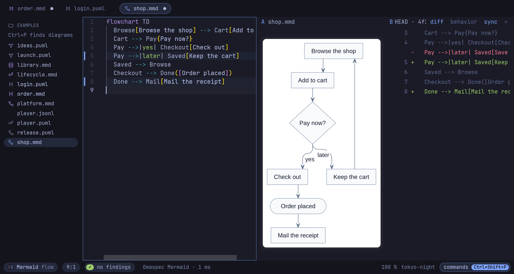

# Reference

Everything Omaspec does, to look up. New here? Start with the
[getting started guide](README.md).

- [Editor](#editor): [keys](#keys), [project and tabs](#project-and-tabs),
  [compare](#compare), [a second monitor](#a-second-monitor), [skin packs](#skin-packs),
  [examples](#examples), [images with their source](#images-with-their-source),
  [session](#session)
- [Preview next to your editor](#preview-next-to-your-editor)
- [Specifications](#specifications)
- [Command line](#command-line)
- [AI agents](#ai-agents)
- [Omarchy](#omarchy)
- [What Omaspec draws](#what-omaspec-draws)

## Editor

```bash
omaspec                      # the last session, or an empty PlantUML diagram
omaspec flow.puml seq.mmd    # adds a tab per file; a new name is created on the first save
omaspec ~/diagrams           # with that folder in the sidebar
```

### Keys

| Keys | |
|---|---|
| Ctrl+Shift+P | every command, as a list; type to filter it |
| Ctrl+P | find a file in the folder by a few letters |
| Ctrl+Shift+E | the examples, as tiles; Enter opens a copy, F5 plays it |
| F5 | play the diagram (a state machine or a scenario) |
| Ctrl+O | open a file, folder or image by path |
| Ctrl+Shift+F, Ctrl+Shift+H | find, and replace, in all tabs (each tab one undo step) |
| Ctrl+S, Ctrl+Shift+S | save (atomic, keeps the line endings), save as |
| Ctrl+Enter | render now |
| F8 | jump to the next lint finding |
| Ctrl+Shift+D | compare with another tab or a git commit |
| Ctrl+Shift+N | the diagram in a window of its own |
| Ctrl+Shift+I, Ctrl+Shift+C | format; copy the diagram as PNG |
| Ctrl+N, Ctrl+W, Ctrl+PageDown/PageUp | new tab, close tab, switch tabs |
| Ctrl+Shift+[, Ctrl+Shift+] | fold the block at the caret, unfold it |
| Ctrl+B, Ctrl+Q | project tree on/off, quit |
| Ctrl+Alt+arrows | move between the project, the editor and the diagram |
| Alt+=, Alt+-, Alt+0, Alt+F | zoom the diagram, 100 %, fit |
| Ctrl+F, Ctrl+H, Ctrl+/, Ctrl+D | in the text: find, replace, comment, next occurrence |
| Super+F | fullscreen (Omarchy's chord for every window) |

The status bar shows the Omaspec mark and `Ctrl+Shift+P`; a click opens the command
list. Export asks for a path in that line (Enter writes it, a second Enter replaces a
file that is already there).

### Project and tabs

The project area is the folder as a tree: one level at a time, directories first, then
every file (hidden names and dependency folders stay out). A folder shows at most 1000
entries, folders and diagrams before other files. Ctrl+P still finds every diagram in
that folder. The project, the editor and the diagram are separate areas; Ctrl+Alt+arrows
moves between them, and an accent border shows which one has the keys.

Lint findings are underlined while you type (F8 jumps to the next); the diagram is drawn
again after a short pause. A click on a render error in the status bar jumps to its line;
so does Ctrl+click on a label, box, diamond or line in the diagram. Lines changed since the last
save are marked beside the line numbers. The language is detected from the text and the
file name unless `--lang` (or the palette) sets it.

A folder with `omaspec-project.toml` is a project: a diagram anywhere below it is
checked against the state machines of the whole project, its `!include`s may reach into
all of it, and it is the same project whether the diagram came from the sidebar, from
Ctrl+O or from the command line. *New project* in the palette asks for PlantUML or
Mermaid, with git or without, then for the folder; it writes the project file and a
first diagram, `system.puml` or `system.mmd`, shows the folder and opens the diagram. A
folder that is there keeps its files. The file names the project, which heads the
sidebar, and its main diagram:

```toml
name = "shop"
main = "system.puml"
```

The palette also opens the *Help Omaspec* folder: diagrams of the menu, editing, the
window and export. The line under its heading, or *Leave Help Omaspec* in the palette,
brings the project folder back and closes the help pages.

### Compare

Ctrl+Shift+D compares the tab (A) with another tab or with the file in a git commit
(`HEAD` and the last 30 commits that changed it) as B: both diagrams side by side, zoomed
and panned together, or B as the source lines that changed from B to A (blank lines and
indentation aside; a click goes to the line). Meanwhile the marks beside the lines show
the difference to B.



### A second monitor

Ctrl+Shift+N moves the diagram into a window of its own (class `omaspec-preview`): the
editor takes the room, the diagram window follows the active tab, has the preview's keys
(`+`/`-`, `0`, `f`), and Ctrl+click there jumps in the editor. Escape or closing it
brings the diagram back.

### Skin packs

Skin packs (in the palette: plain, spec, presentation, Omarchy colors) put a look into
the source itself, so it stays with the file, exports and copies: `skinparam` lines after
`@startuml`, or an `%%{init}%%` line in Mermaid, marked so that the next pack replaces
it. The Omarchy pack writes the active theme's colors in.

**Diagram theme: follow Omarchy** colors the picture with the active theme without
changing the file, and follows a theme switch. Mermaid's own `%%{init}%%` lines (theme,
colors, font) are honored too.

### Lines by hand

The layout lays every line, and you can shape one yourself: hold **Alt** over the
diagram, and the line under the pointer lights with its corners as dots. Alt and a drag
on a straight run moves that run sideways, the runs beside it stretching to follow; the
pointer shows which way it goes. Alt and a drag on a dot moves that corner, and the runs
on either side with it. While you drag, the line shows exactly how it will be drawn; no
router lays it again, so what you let go is what stays. A straight line dragged sideways
slides along the sides of its boxes while it can, and steps around them when it cannot.
Alt and a double click gives the line back to the layout. Escape stops a drag, and Ctrl+Z
takes one back. The palette's *Lines by hand* commands reset the line at the caret, or
every line.

The shape goes into the source as comments at the end of the diagram, so it travels with
the file, its copies and its images, and PlantUML and Mermaid read past it:

```plantuml
' lines by hand (Omaspec)
' Idle -> Running at 0.5 -0.4
' Running -> Idle #2 at 1.2 0.3, 1.2 0.8
```

A line is named by its two ends, `#2` for the second line between the same two. Each
pair after `at` is a corner, as a share of the space the two boxes take together: across
(0 at its left, 1 at its right) and down (0 at its top, 1 at its bottom), so the shape
grows and shrinks with its boxes when the diagram changes, and its runs stay straight. A
line takes up to 32 corners. A corner inside one of its boxes, or a line that is gone, is
left out and shows among the findings, and so does a line that runs through a box. Lines
by hand work in state, class, component, use case, deployment and object diagrams and in
Mermaid flowcharts; the preview window shows them but leaves the dragging to the editor.
Why it works this way: [ADR 0016](../adr/0016-lines-by-hand.md).

### Examples

Ctrl+Shift+E (or *Examples* on an empty page) lays the examples that come with Omaspec
out as tiles: a coffee machine's states, a pizza night's scenario, a first day at work in
swimlanes, a washing machine's timing, a bookshop's classes, a garden year as a mind map,
a treehouse as a Gantt chart and more, 24 in PlantUML and Mermaid. Seven are complex (an
elevator, a checkout, an incident in three lanes, a delivery pipeline, a library system
and more) and have a *complex* filter of their own.

Each tile is drawn on the spot by Omaspec's engines, in the colors the diagram pane would
show; the *Omarchy colors* switch redraws them all in the theme's. Typing filters (by
title, kind, language, or `complex`), Tab steps through behavior, structure, plans and
data, the arrows move between tiles. Enter (or a click) opens a copy in a new tab,
unsaved, under a free name in the project folder; F5 (or the *plays* badge) opens it and
plays it. `omaspec example` lists them on the command line, and `omaspec example NAME`
prints one.


### Images with their source

Exported PNGs and SVGs carry the diagram source. Dropped on the window or opened with
Ctrl+O, such an image opens as a new, unsaved tab under a name nothing has yet
(`flow-2.mmd` next to `flow.mmd`), so saving never overwrites the original.
`omaspec extract diagram.png` prints the source.

### Session

The window keeps its session in `~/.local/state/omaspec/` (readable by you only): open
tabs with their unsaved text, the folder, the caret. Closing the window loses nothing; the
next start brings it all back. Closing a tab with unsaved changes asks once in the status
bar. A second window works without a session. A file changed on disk is reloaded when its
tab has no unsaved changes.

## Preview next to your editor

```bash
omaspec preview flow.puml   # a window that renders again on every save
```

Edit in Neovim (or anything else) and keep the preview tiled next to it. Errors show in
the status bar while the last good picture stays.

| Keys | |
|---|---|
| `+` / `-`, `0`, `f` | zoom, 100 %, fit |
| `h` `j` `k` `l` | pan |
| `c`, `C` | copy as PNG, copy as SVG |
| `p` | play the diagram |
| `r`, `q` | render again, quit |

The mouse wheel zooms at the pointer, two-finger scroll and dragging pan, Ctrl +
two-finger scroll zooms, a double click fits, and Ctrl+click names the source line of
what is drawn there. Lines by hand are drawn here as the file has them; dragging them is
the editor's.

## Specifications

Omaspec reads a state diagram, in PlantUML or in Mermaid, as the state machine it
specifies, and a sequence diagram as a scenario
([ADR 0007](../adr/0007-behavior-specifications.md)).

**Checks while you type.** A state no path from the start reaches, a state nothing
leaves, the same event leading from one state to two others with no guard to choose, a
composite state entered with no start inside. Transition labels are read as UML writes
them, `event [guard] / action`.

**Scenarios against machines.** A sequence diagram is checked against the state machines
of its project: a participant named like a state diagram (`door.puml`, or `title Door`)
must take every message it receives as an event, in the order the scenario sends them,
through `alt`, `opt` and `loop`.

**Play it.** F5 (`p` in the preview window) runs the diagram on screen. A state machine
starts: the rest of the diagram sinks under a veil, the states it is in shine through it,
and the bar below offers what can happen next, numbered 1 to 9; a light runs along the
transition's route to the next state, regions start side by side, a choice (or a state
with several ways out) waits for you to pick one, and a history goes back to where its
state was left. A scenario unfolds message by message (Space), a light running along each
arrow. Each step lights its line in the source; ← goes back, Home starts again, Esc stops.

**Traces.** `omaspec trace run.jsonl` reads what a running system did, one JSON object per
line (`{"object":"Door","event":"open","state":"Opening"}`, with `time` and other fields
as the log has them), and plays it through the state machines of its project: an event the
object cannot take where it is by then, or a state it cannot be in, is an error with the
time and the states it could be in. Many objects can share one machine
(`"machine":"Door"`). In the editor, *Play a recorded trace* (command menu) plays it in
the diagram, line by line with Space: the bar shows the time and the event, the states
light up, and where the trace deviates the bar turns red and says why.
[examples/player.jsonl](../../examples/player.jsonl) is an evening of the media player.

**What changed, and in the other language.** `omaspec diff` compares two versions, or a
file with its last commit, by states, transitions and messages, not by lines; layout and
colors do not count. `omaspec convert` writes a machine or scenario in the other language,
and only when the result means the same ([ADR 0009](../adr/0009-diff-and-convert.md)).

## Command line

```bash
omaspec new ~/specs/shop            # a project: omaspec-project.toml and system.puml; --lang mermaid, --git
omaspec lint diagrams/*.puml        # syntax, likely typos, specification checks; exit 1 on errors
omaspec lint --project specs a.puml # sequences checked against the state machines in specs/, not the project
omaspec lint --strict --json a.mmd  # warnings fail too; JSON for scripts
omaspec trace run.jsonl             # a recorded trace against the state machines of its project; --project, --json
omaspec fmt --write diagrams/*.puml # re-indent in place (atomic); --check for CI
omaspec outline flow.puml           # structure: participants, groups, lanes, states, …
omaspec inspect flow.puml           # language, kind, findings, outline, and whether Omaspec draws it
omaspec diff door.puml              # what changed in the behavior since the last commit; --rev, or two files
omaspec convert door.puml -o door.mmd  # the same machine or scenario in Mermaid (or PlantUML), or why not
omaspec render flow.mmd             # flow.svg next to it, with the source inside
omaspec render flow.mmd --json      # where the image went, or the error and its line, as JSON
omaspec render flow.mmd -o flow.png # PNG (2x), JPEG, PDF, Markdown or ZIP by extension; --copy for the clipboard
omaspec extract diagram.png         # the source stored in an exported PNG or SVG
omaspec example                     # the examples of the gallery; `example NAME` prints one, --json
omaspec theme                       # the palette Omaspec reads from your Omarchy theme
```

`lint`, `fmt --check` and `trace` exit with 1 when they find something, so they work in
CI and in git hooks.

## AI agents

`omaspec mcp` is a Model Context Protocol server over standard input and output
([ADR 0008](../adr/0008-mcp-server.md)): an agent lints a diagram, holds a trace against
the state machines of its project, formats it, and renders it, getting a PNG back to look
at. The tools are the command line's (`lint`, which also takes a folder, `trace`,
`inspect`, `outline`, `diff`, `convert`, `format`, `render`), with the same findings and
one-based lines. Nothing goes over the network.

```bash
claude mcp add omaspec -- omaspec mcp   # Claude Code
```

Other clients take the same command in their server list, for example
`{"mcpServers": {"omaspec": {"command": "omaspec", "args": ["mcp"]}}}`. Relative paths
are read from the folder the client starts the server in.

## Omarchy

Omaspec follows theme switches and `omarchy font set` while it runs. Every bundled theme
is checked for legible colors; faint ones (a yellow on white) are deepened just enough to
read.


Templates in [packaging/omarchy](../../packaging/omarchy) (installed to
`/usr/share/omaspec/omarchy` by the AUR package):

- `hyprland.lua`: SUPER+SHIFT+U opens the editor. SUPER+F stays Omarchy's fullscreen for
  the whole window. Window rules for the diagram windows are commented there.
- `omarchy-menu.jsonc`: a "Diagram editor" entry for the Omarchy menu.
- `omaspec.toml.tpl`: copy it to `~/.config/omarchy/themed/` to set Omaspec's syntax and
  mark colors per theme with Omarchy's placeholders (`{{ accent }}`, `{{ blue }}`,
  `{{ mix background foreground 40% }}`). `omaspec theme` shows what it took.

Copies to the clipboard and exports send an Omarchy notification. Window classes for
Hyprland rules: `omaspec` (editor), `omaspec-preview` (preview window and the editor's
diagram window).

## What Omaspec draws

Mermaid renders natively, and so do most PlantUML diagrams, with Omaspec's own engines:
sequence, activity, state, class, component, use case, deployment, object, timing and
Gantt diagrams, mind maps, WBS, JSON and formulas (`@startlatex`, `@startmath`), and
Mermaid flowcharts, state and sequence diagrams. The other Mermaid types are drawn by
[mmdr](https://github.com/1jehuang/mermaid-rs-renderer), a Rust library, in the same
process. The other PlantUML types (YAML, network diagrams, Salt and more) render through
the optional `plantuml` package, confined with Landlock. Lines between states and between
boxes curve, as PlantUML and Mermaid draw them; `skinparam linetype ortho` keeps right
angles. Omaspec also has a diagram of its own, signal flow (`@startflow`,
[ADR 0010](../adr/0010-signal-flow.md)). The [roadmap](../../ROADMAP.md) has the details.
