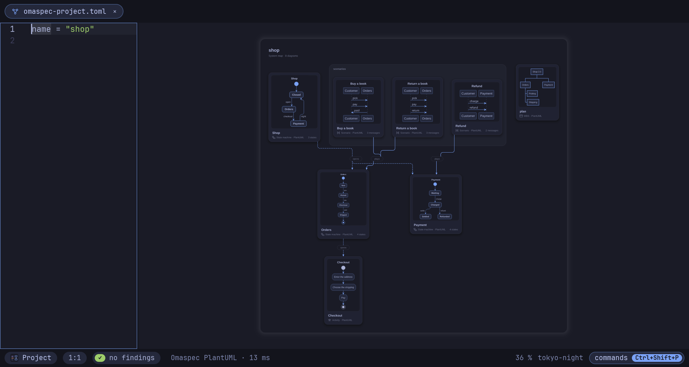
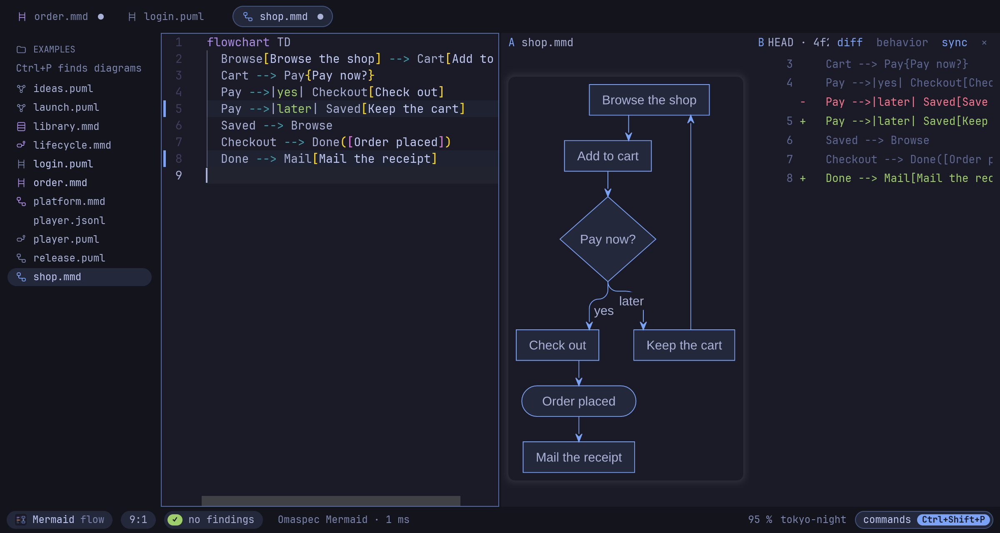
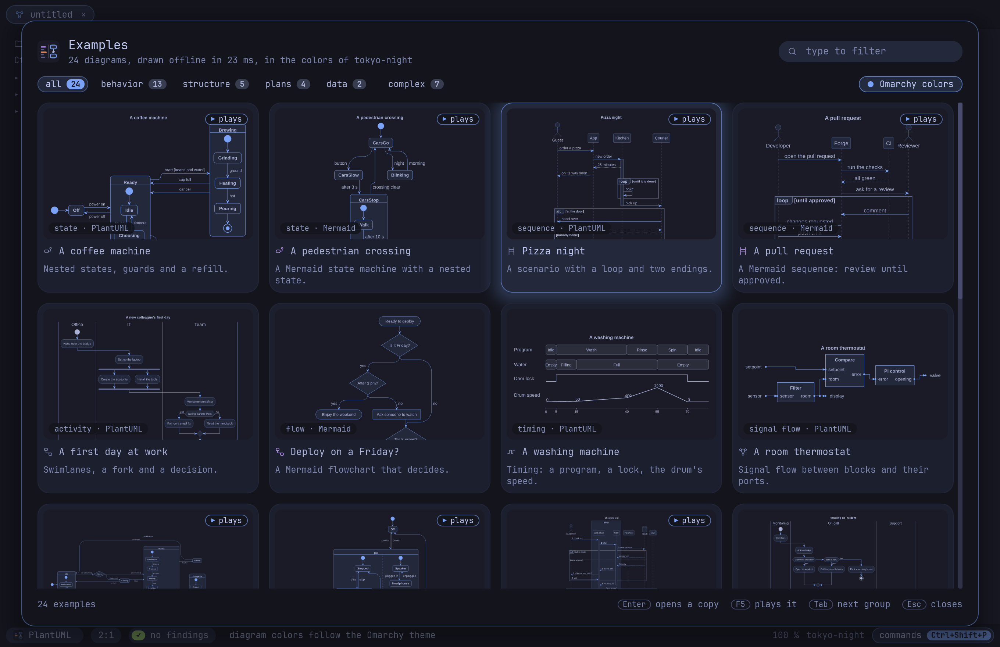
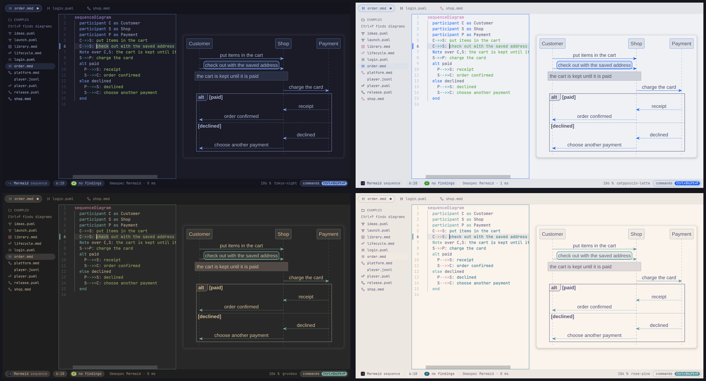

# Reference

Everything Omaspec does, to look up. New here? Start with the
[getting started guide](README.md).

- [Editor](#editor): [keys](#keys), [project and tabs](#project-and-tabs),
  [diagrams that link](#diagrams-that-link), [compare](#compare), [a second monitor](#a-second-monitor), [skin packs](#skin-packs),
  [fold and focus](#fold-and-focus), [examples](#examples), [images with their source](#images-with-their-source),
  [session](#session)
- [Preview next to your editor](#preview-next-to-your-editor)
- [Specifications](#specifications)
- [Command line](#command-line)
- [AI agents](#ai-agents)
- [Omarchy](#omarchy)
- [What Omaspec draws](#what-omaspec-draws)

## Editor

```bash
omaspec                      # the last session, or an empty PlantUML diagram
omaspec flow.puml seq.mmd    # adds a tab per file; a new name is created on the first save
omaspec ~/diagrams           # with that folder in the sidebar
```

### Keys

| Keys | |
|---|---|
| Ctrl+Shift+P | every command, as a list; type to filter it |
| Ctrl+P | find a file in the folder by a few letters |
| Ctrl+Shift+E | the examples, as tiles; Enter opens a copy, F5 plays it |
| F5 | play the diagram (a state machine or a scenario) |
| Ctrl+O | open a file, folder or image by path |
| Ctrl+Shift+F | find in every file of the project, the open tabs first; a hit opens its file |
| Ctrl+Shift+H | replace in all tabs (each tab one undo step) |
| Ctrl+F in the diagram | find a state, a message or any label; it lights up and comes into sight |
| F2 | rename the diagram, state or event at the caret at every use in the project |
| Ctrl+S, Ctrl+Shift+S | save (atomic, keeps the line endings), save as |
| Ctrl+Enter | render now |
| F8 | jump to the next lint finding |
| Ctrl+Shift+D | compare with another tab, a git commit, or the project since one |
| Ctrl+Shift+N | the diagram in a window of its own |
| Ctrl+Shift+I, Ctrl+Shift+C | format; copy the diagram as PNG |
| Ctrl+N, Ctrl+W, Ctrl+PageDown/PageUp | new tab, close tab, switch tabs |
| Ctrl+Shift+[, Ctrl+Shift+] | fold the block at the caret, unfold it |
| Ctrl+B, Ctrl+Q | project tree on/off, quit |
| Ctrl+Alt+arrows | move between the project, the editor and the diagram |
| Alt+=, Alt+-, Alt+0, Alt+F | zoom the diagram, 100 %, fit |
| click, Alt+Left | into a linked state or a tile of a map, and back out |
| Shift+click | focus on a box and its neighbors; on paper, end it |
| right click | a menu of the actions for what is under the pointer: in the diagram the box or the line there, in the text the caret; the arrows and Enter work in it |
| Alt, F10 | a tap on Alt shows or hides the menu bar (File, Edit, View, Diagram, Project, Help, every entry with its keys) and, with it, a toolbar over the diagram (View › Toolbar on/off); F10 opens File; Left and Right walk the menus |
| Ctrl+F, Ctrl+H, Ctrl+/, Ctrl+D | in the text: find, replace, comment, next occurrence |
| Super+F | fullscreen (Omarchy's chord for every window) |

The status bar shows the Omaspec mark and `Ctrl+Shift+P`; a click opens the command
list. Export asks for a path in that line (Enter writes it, a second Enter replaces a
file that is already there), and for a look: as the diagram shows, in the file's own
colors, plain, light, dark, or for an SVG auto. Tab takes the next, a click takes one.
The image keeps the file's own source whatever the look.

### Project and tabs

The project area is the folder as a tree: one level at a time, directories first, then
every file (hidden names and dependency folders stay out). A folder shows at most 1000
entries, folders and diagrams before other files. Ctrl+P still finds every diagram in
that folder. The project, the editor and the diagram are separate areas; Ctrl+Alt+arrows
moves between them, and an accent border shows which one has the keys.

Lint findings are underlined while you type (F8 jumps to the next); the diagram is drawn
again after a short pause. A click on a render error in the status bar jumps to its line;
so does Ctrl+click on a label, box, diamond or line in the diagram. Lines changed since the last
save are marked beside the line numbers. The language is detected from the text and the
file name unless `--lang` (or the palette) sets it.

A folder with `omaspec-project.toml` is a project: a diagram anywhere below it is
checked against the state machines of the whole project, its `!include`s may reach into
all of it, and it is the same project whether the diagram came from the sidebar, from
Ctrl+O or from the command line. *New project* in the palette asks for PlantUML or
Mermaid, with git or without, then for the folder; it writes the project file and a
first state machine named after the project, shows the folder and opens the project's
map. A folder that is there keeps its files. The file names the project, which heads the
sidebar:

```toml
name = "shop"
```

### A look the project pins

A `[look]` table in `omaspec-project.toml` is what every diagram of the project is
drawn in: in the pane (over the theme's colors), by `render`, the MCP server, `export`
and CI alike. The file and the source stored in an image stay as written.

```toml
[look]
pack = "light"        # plain, spec, presentation, sketch, vivid, light, dark, or auto (light, and dark under a dark scheme)
accent = "#d73a49"    # with light or dark: background, surface, text, accent, muted, note
font = "Inter"        # skinparam defaultFontName, Mermaid's fontFamily
```

A line that does not hold is named. `omarchy` is refused there, as it differs from
machine to machine; `render --look` still takes it, and `--look file` the file's own
colors. An SVG is laid out the same on every machine (text is measured on built-in
metrics); a PNG depends on the fonts installed. The layout keeps improving, so an update
may draw a project otherwise: `omaspec render --check .` draws every diagram and holds it
against the SVG beside it, writing nothing, and names what changed: the diagram changed
since its SVG was drawn, or the same diagram drawn differently (its size, words new or
gone, parts moved, parts in other colors). It exits 1 then, for CI; `omaspec render .`
draws them again, to commit.

### Diagrams that link

The diagrams of a project link by name ([ADR 0018](../adr/0018-diagrams-that-link.md)): a
state named `Checkout` links to the diagram called Checkout (by the name after
`@start…`, its title or its file name, letters and digits only, case aside), and carries
a mark of two small squares. A click on it glides into the state and opens that diagram;
a trail over the diagram names the way, `shop › Orders › Checkout`. A click on one of its
names, or Alt+Left, zooms back out. A drag still pans and Ctrl+click still jumps to the
source.

A project's map is made from its diagrams, and written nowhere
([ADR 0026](../adr/0026-the-map-is-made.md)): `omaspec-project.toml` opened in the editor
shows it beside the file. Each diagram file of the project is a tile with that diagram's
picture, drawn by Omaspec's engines in the map's colors, sharp at any zoom; none has to
be listed, and a new file is on the map as soon as it is there. An arrow joins two tiles
where a scenario *plays* against a state machine, a state *opens* the diagram of its
name, or a diagram *includes* a file, and the map is laid out by these arrows: a diagram
stands above the one it leads to. Arrows that arrive alike at one tile meet in their
words and share one head; more than four tiles that lead to the same diagrams stand in a
block with one line. What no arrow joins stands beside one another, the diagrams no arrow
reaches in a block. A folder is a frame around its diagrams; in a project
of more than 36 diagrams a folder is a tile that shows how much it holds, a small box for
each diagram, and a click on it opens the folder's map in the same tab, the trail naming
the way back. A large map shows its cards first, each with its diagram's name and kind,
and the pictures once the tiles are large enough to read. A click on a tile zooms into
its diagram. A diagram open in a tab shows on the map as the tab holds it, saved or not.
A mind map and a WBS are diagrams like any other: they draw as PlantUML and Mermaid draw
them, and on the map each is one tile. `omaspec render DIR/omaspec-project.toml` draws
the map (`omaspec render DIR` writes it as `omaspec-project.svg` beside the diagrams'
SVGs, and `render --check` holds it against the project); the preview window shows it for
the project's file. Ctrl+click on a tile opens its diagram too: a map has no source to
jump to.



The palette also opens the *Help Omaspec* folder: diagrams of the menu, editing, the
window and export. The line under its heading, or *Leave Help Omaspec* in the palette,
brings the project folder back and closes the help pages.

### Compare

Ctrl+Shift+D compares the tab (A) with another tab or with the file in a git commit
(`HEAD` and the last 30 commits that changed it) as B: both diagrams side by side, zoomed
and panned together, or B as the source lines that changed from B to A (blank lines and
indentation aside; a click goes to the line). Meanwhile the marks beside the lines show
the difference to B. *Compare: glide from B to A* in the palette shows the change as a
glide in A's pane: B stands as it was, then its boxes and lines glide to their places in
A, what came fades in and what went fades out.

The same list offers *the project since* `HEAD`, its five newest tags and the commits that
changed it: what changed in the behavior of every diagram of the project since then, the
open tabs as they are, as `omaspec diff DIR --rev` tells it. Typing filters the changes by
their words and their files; Enter opens the file where it changed, next to the version
of that commit (a removed diagram only says so). What is gone is named on its line then,
`door.puml@HEAD:6`.



### A second monitor

Ctrl+Shift+N moves the diagram into a window of its own (class `omaspec-preview`): the
editor takes the room, the diagram window follows the active tab, has the preview's keys
(`+`/`-`, `0`, `f`), and Ctrl+click there jumps in the editor. Escape or closing it
brings the diagram back.

### Skin packs

Skin packs (in the palette: plain, spec, presentation, Omarchy colors, sketch, vivid)
put a look into the source itself, so it stays with the file, exports and copies:
`skinparam` lines after `@startuml`, or an `%%{init}%%` line in Mermaid, marked so that
the next pack replaces it. Plain draws black lines and frames on white and fills nothing;
spec draws in black and white, strict UML, in a serif. Presentation draws
larger, with round corners, in one blue on white. Vivid has a palette by kind: blue boxes,
violet interfaces, pink choices, green databases and queues, amber actors and
participants, yellow notes, slate lines. The Omarchy pack writes the active theme's
colors in.

In a Mermaid flowchart the packs color the shapes by kind too: decisions, terminals
(stadiums and circles) and cylinders apart from the boxes, which Mermaid itself does not.

The sketch pack draws the diagram by hand, in pastel colors on warm paper (light blue
boxes, orange actors, rose decisions, green stores, yellow notes, dark ink): `skinparam handwritten true` in PlantUML,
`look: handDrawn` in Mermaid (in `%%{init}%%`, or in the front matter's `config`), the
way both languages already ask for it. Every line, border and fill is drawn by hand, a
little bowed, and a card that had no border gains a light rim. A label's ground and a
highlight stay straight, so they still cover what is under them. A fill that only sits
inside another shape stays straight as well. The words are set in a handwriting
face, still measured as the plain font, so a box stays the size it was. The hand
is steady: a box takes its strokes
from its name, so the same file draws the same picture every time, and a box keeps its
strokes when the layout moves it.
Why: [ADR 0023](../adr/0023-sketch-look.md).

Diagrams are drawn in the active theme's colors, without changing the file, and follow
a theme switch; **Diagram theme: follow Omarchy** in the palette switches between that
and the file's own colors. Colors the file sets itself (`skinparam`, `classDef`, `style`)
stay its own, and two of them that hardly differ, under 3:1, are a finding. Mermaid's
own `%%{init}%%` lines (theme, colors, font) are honored too.

A skin colors by kind, so every state of a machine is one color. **Color this box…** in
the palette, or in the menu of the right mouse button over a box, offers the window's
colors for the state or class the caret is on, and *no color of its own*. The color goes
into the source as the language writes it (`state Busy #f7768e`, `class Order #ffcc00`,
Mermaid's `style Busy fill:#f7768e`), as one undo step, so every other tool draws it too.

### Lines by hand

The layout lays every line, and you can shape one yourself: hold **Alt** over the
diagram, and the line under the pointer lights with its corners as dots. Alt and a drag
on a straight run moves that run sideways, the runs beside it stretching to follow; the
pointer shows which way it goes. Alt and a drag on a dot moves that corner, and the runs
on either side with it. While you drag, the line shows exactly how it will be drawn; no
router lays it again, so what you let go is what stays. A straight line dragged sideways
slides along the sides of its boxes while it can, and steps around them when it cannot.
Alt and a double click gives the line back to the layout. Escape stops a drag, and Ctrl+Z
takes one back. The palette's *By hand* commands reset the line (or the box) at the caret,
or every line and box.

The shape goes into the source as comments at the end of the diagram, so it travels with
the file, its copies and its images, and PlantUML and Mermaid read past it:

```plantuml
' lines by hand (Omaspec)
' Idle -> Running at 0.5 -0.4
' Running -> Idle #2 at 1.2 0.3, 1.2 0.8
```

A line is named by its two ends, `#2` for the second line between the same two. Each
pair after `at` is a corner, as a share of the space the two boxes take together: across
(0 at its left, 1 at its right) and down (0 at its top, 1 at its bottom), so the shape
grows and shrinks with its boxes when the diagram changes, and its runs stay straight. A
line takes up to 32 corners. A corner inside one of its boxes, or a line that is gone, is
left out and shows among the findings, and so does a line that runs through a box. Lines
by hand work in state, class, component, use case, deployment and object diagrams and in
Mermaid flowcharts; the preview window shows them but leaves the dragging to the editor.
Why it works this way: [ADR 0016](../adr/0016-lines-by-hand.md).

### Boxes held in place

A box can be moved too, to a place among the others. Hold **Alt** over a box (where no
line runs) and it lights; Alt and a drag takes its outline along, and a bar shows where it
would go: between two boxes of the rank nearest the pointer. Let go, and the box stays
there, beside its neighbor. The same block keeps it:

```plantuml
' lines by hand (Omaspec)
' Paused before Running
' Error after Idle
```

`Paused before Running` keeps *Paused* in the rank of *Running*, right before it (left of
it when the flow runs down, above it when it runs across); `after`, right after it. No
coordinates are kept, so the box holds its place in any theme and font, and when the
diagram grows. Lines by hand on it move with it. A box stays in its container, and a
box joined to another by a line cannot stand in its rank; where an entry cannot hold, a
name is gone, or two entries go round, the box stands where the layout puts it and the
entry shows among the findings. Alt and a double click gives the box back to the
layout. Renaming a state renames it in the block too. Why it works this way:
[ADR 0021](../adr/0021-boxes-held-in-place.md).

### Lines bundled

Where several lines arrive at one box, they meet on one short stem beside it, so the
box has one arrival instead of a comb. Through the ranks each line keeps its own run,
and a label keeps the room it has; the lines turn onto the stem only as they arrive. A
line with a label keeps its own arrival, and so does one with a multiplicity at an
end. So do the lines that leave a box, and two lines between the same two boxes. Only
lines that arrive alike share a stem: the same arrowhead, color, width and dash, so an
inheritance triangle never sits on an arrow and a dashed line never hides under a
solid one. Arrowheads on the stem stack, the later line on top.

The same block turns that off:

```plantuml
' lines by hand (Omaspec)
' apart
' apart at Done
```

`apart` keeps every line of the diagram on its own arrival. `apart at Done` does that
for the lines that meet *Done*. A repeated entry is a warning, and a name that is no
box shows among the findings, in the editor and from `omaspec lint` and `check`.
Renaming a box renames it here too. *By hand: reset every line and box* removes these
entries with the rest of the block. Why it works this way:
[ADR 0022](../adr/0022-lines-bundled.md).

### Fold and focus

A large diagram can be read a part at a time. Over a nested state, a package or a
subgraph the pointer shows a small button in its top right corner: a click folds it to a
box of its own, its lines ending on the box, and the box carries the two small squares of
a state with a diagram inside and says what it holds (*4 states · 6 transitions*; a
package *3 elements · 2 lines*). The picture fades into the folded one, and when
the diagram is zoomed the box stays where it was. A click on the folded box unfolds
it. The palette folds or
unfolds the container whose name the caret is on, and unfolds every container. Folds are
the pane's, not the file's: nothing is written, the checks and a play see the whole
diagram, and a play unfolds everything before it starts. An export draws what the pane
shows.

Shift and a click on a box puts it in focus: the rest of the diagram goes quiet behind a
veil, and the box, the boxes its lines lead to or come from, those lines and their words
come through. In the editor the focus follows the caret onto another box's name; Shift and
a click on the paper, or the palette's *Focus* command, ends it. Both work in state,
class, component and deployment diagrams and in Mermaid flowcharts. Why:
[ADR 0024](../adr/0024-focus-and-collapse.md).

### Examples

Ctrl+Shift+E (or *Examples* on an empty page) lays the examples that come with Omaspec
out as tiles: a coffee machine's states, a pizza night's scenario, a first day at work in
swimlanes, a washing machine's timing, a bookshop's classes, a garden year as a mind map,
a treehouse as a Gantt chart and more, 24 in PlantUML and Mermaid. Seven are complex (an
elevator, a checkout, an incident in three lanes, a delivery pipeline, a library system
and more) and have a *complex* filter of their own.

Each tile is drawn on the spot by Omaspec's engines, in the colors the diagram pane would
show, cut to the diagram and filling the tile; a tall one shows its top. The tiles fill
the panel, fewer and larger in a narrow window. The *Omarchy colors* switch redraws them
all in the file's own colors or the theme's. Typing filters (by
title, kind, language, or `complex`), Tab steps through behavior, structure, plans and
data, the arrows move between tiles. Enter (or a click) opens a copy in a new tab,
unsaved, under a free name in the project folder; F5 (or the *plays* badge) opens it and
plays it. `omaspec example` lists them on the command line, and `omaspec example NAME`
prints one.



### Images with their source

Exported PNGs and SVGs carry the diagram source. Dropped on the window or opened with
Ctrl+O, such an image opens as a new, unsaved tab under a name nothing has yet
(`flow-2.mmd` next to `flow.mmd`), so saving never overwrites the original.
`omaspec extract diagram.png` prints the source.

### Markdown documents

A `.md` file is a document of diagrams: every fenced block that names `plantuml`, `puml`,
`mermaid` or `mmd` is one, highlighted in its language, linted and checked on the
document's lines. A PlantUML block without `@startuml` is read inside it, as GitLab draws
it. The pane draws the diagram the caret is in (or the last one above it); a Ctrl+click,
a play and an error land on the document's lines, and an export or a copy is that diagram
alone, as `README-2.svg` with its source as `README-2.puml`. Formatting re-indents each
diagram in its place, the prose as it is; skin packs, converting, lines by hand and the
language commands work on diagram files only, and say so. The
preview window shows all of a document's diagrams one under another. A document's state
machines belong to its project, named by `@startuml Name` or `title`. On the command line
and over MCP, `lint`, `inspect`, `render` and `outline` take a document's diagrams on its
lines, and `fmt` formats each of them in its place, leaving the prose as it is; `convert`
and `diff` take a diagram file and say so for a document.

### A project to hand on

*Export the project* in the command list, or `omaspec export DIR`, writes every diagram
of the project as an SVG with its source into its `export` folder (or the one `-o`
names), beside one another as the diagrams are, the project's map as `index.svg` (and
the map of a folder that is a tile on it as `index.svg` in that folder), and all of it as
`<project>.zip` in that folder. Each tile of a map and each
state that opens a diagram links to that diagram's SVG, so a browser is enough to follow
them; the look is the export's (`--look auto` follows the viewer's dark scheme). Links
written in a diagram stay links in an SVG: PlantUML's `[[url]]`, `[[url label]]` and
`[[url{tooltip}]]` in text or on an element (`class Order [[docs/order.html]]`), and
Mermaid's `click A href "url"` or a class's `link`; a callback is left out. A diagram
that does not draw is named and left out; nothing is written outside the folder, and an
SVG an earlier export left there stays.

### Session

The window keeps its session in `~/.local/state/omaspec/` (readable by you only): open
tabs with their unsaved text, the folder, the caret. Closing the window loses nothing; the
next start brings it all back. Closing a tab with unsaved changes asks once in the status
bar. A second window works without a session. A file changed on disk is reloaded when its
tab has no unsaved changes. A diagram of the project changed by another program, an agent
or a `git checkout` shows on its maps and links at once.

## Preview next to your editor

```bash
omaspec preview flow.puml   # a window that renders again on every save
```

Edit in Neovim (or anything else) and keep the preview tiled next to it. Errors show in
the status bar while the last good picture stays.

| Keys | |
|---|---|
| `+` / `-`, `0`, `f` | zoom, 100 %, fit |
| `h` `j` `k` `l` | pan |
| `c`, `C` | copy as PNG, copy as SVG |
| `p` | play the diagram |
| `r`, `q` | render again, quit |
| click, Backspace | into a linked state or a tile of a map, and back |
| `u`, Shift+click, Escape | unfold every container; focus on a box; end the focus |

The mouse wheel zooms at the pointer, two-finger scroll and dragging pan, Ctrl +
two-finger scroll zooms, a double click fits, and Ctrl+click names the source line of
what is drawn there. Lines by hand are drawn here as the file has them; dragging them is
the editor's.

## Specifications

Omaspec reads a state diagram, in PlantUML or in Mermaid, as the state machine it
specifies, and a sequence diagram as a scenario
([ADR 0007](../adr/0007-behavior-specifications.md)).

**Checks while you type.** A state no path from the start reaches, a state nothing
leaves, the same event leading from one state to two others with no guard to choose, a
composite state entered with no start inside. Transition labels are read as UML writes
them, `event [guard] / action`. In PlantUML a name is one state in the whole diagram, so
a name written again in another composite state or region is the first one; lint says so
where it happens. A state machine Omaspec does not read is never passed over in silence:
lint says why its checks skip it.

**Scenarios against machines.** A sequence diagram is checked against the state machines
of its project: a participant named like a state diagram (`door.puml`, or `title Door`)
must take every message it receives as an event, in the order the scenario sends them,
through `alt`, `opt` and `loop`.

**Play it.** F5 (`p` in the preview window) runs the diagram on screen. A state machine
starts: the rest of the diagram sinks under a veil, the states it is in shine through it,
and the bar below offers what can happen next, numbered 1 to 9; a light runs along the
transition's route to the next state, regions start side by side, a choice (or a state
with several ways out) waits for you to pick one, and a history goes back to where its
state was left. A scenario unfolds message by message (Space), a light running along each
arrow. Each step lights its line in the source; ← goes back, Home starts again, Esc stops.

**Traces.** `omaspec trace run.jsonl` reads what a running system did, one JSON object per
line (`{"object":"Door","event":"open","state":"Opening"}`, with `time` and other fields
as the log has them), and plays it through the state machines of its project: an event the
object cannot take where it is by then, or a state it cannot be in, is an error with the
time and the states it could be in. Many objects can share one machine
(`"machine":"Door"`). In the editor, *Play a recorded trace* (command menu) plays it in
the diagram, line by line with Space: the bar shows the time and the event, the states
light up, and where the trace deviates the bar turns red and says why.
[examples/player.jsonl](../../examples/player.jsonl) is an evening of the media player.

**What changed, and in the other language.** `omaspec diff` compares two versions, or a
file with its last commit, by states, transitions and messages, not by lines; layout and
colors do not count. Given a folder, it does so for the whole project: every diagram that
changed in its behavior, came, went or moved, and every scenario that a changed machine
no longer plays, as a changelog of the specification. `omaspec log` tells it for one
diagram, commit by commit, following it where it was renamed. After `omaspec git setup`,
git itself does: `git diff`, `git log -p` and `git show` compare a state machine's sorted
states, transitions and findings and a scenario's messages, not its lines
(`--no-textconv` shows the lines). The setup writes `.gitattributes`, to commit, and the
command into the repository's own configuration, as git takes none from a repository: in
another clone, run it once. `omaspec convert` writes a machine or scenario in the other language,
and only when the result means the same ([ADR 0009](../adr/0009-diff-and-convert.md)).

## Command line

```bash
omaspec new ~/specs/shop            # a project: omaspec-project.toml and shop.puml, its map made from them; --lang mermaid, --git (a pre-commit hook)
omaspec lint diagrams/*.puml        # syntax, likely typos, specification checks; exit 1 on errors
omaspec lint --project specs a.puml # sequences checked against the state machines in specs/, not the project
omaspec lint --strict --json a.mmd  # warnings fail too; JSON for scripts
omaspec trace run.jsonl             # a recorded trace against the state machines of its project; --project, --json
omaspec refs Door                   # every use of a diagram, state or event in the project; --machine, --json
omaspec rename Door Gate            # renamed at every use; --state, --event, --machine, --dry-run, --json
omaspec fmt --write diagrams/*.puml # re-indent in place (atomic); --check for CI
omaspec outline flow.puml           # structure: participants, groups, lanes, states, …
omaspec inspect flow.puml           # language, kind, findings, outline, and whether Omaspec draws it
omaspec diff door.puml              # what changed in the behavior since the last commit; --rev, or two files
omaspec diff . --rev v1.0           # the same for the whole project since a tag; or two folders
omaspec log door.puml               # commit by commit, what each changed in the behavior; -n 5, --json
omaspec git setup                   # git diff, git log -p and git show tell diagrams by their behavior
omaspec convert door.puml -o door.mmd  # the same machine or scenario in Mermaid (or PlantUML), or why not
omaspec render flow.mmd             # flow.svg next to it, with the source inside
omaspec render flow.mmd --json      # where the image went, or the error and its line, as JSON
omaspec render flow.mmd -o flow.png # PNG (2x), JPEG, PDF, Markdown or ZIP by extension; --copy for the clipboard
omaspec render door.puml -o -  --format text   # its behavior, one fact a line, for an agent or a terminal; or -o door.txt
omaspec render flow.mmd --look auto # plain, sketch, vivid, omarchy, light or dark; auto: one SVG, dark under a dark scheme
omaspec render .                    # every diagram of the folder, each beside its own, in the project's look
omaspec render --check .            # writes nothing: each SVG against the one beside it, what changed; exit 1
omaspec check ~/specs/shop          # lint, the machines, the links and render --check; --strict, --json, --github
omaspec export ~/specs/shop         # every diagram as an SVG, linked, the map as index.svg, and shop.zip, in shop/export
omaspec lint README.md              # each plantuml and mermaid block of a Markdown document, on its lines
omaspec render README.md            # one image per block: README-1.svg, README-2.svg, …
omaspec extract diagram.png         # the source stored in an exported PNG or SVG
omaspec example                     # the examples of the gallery; `example NAME` prints one, --json
omaspec theme                       # the palette Omaspec reads from your Omarchy theme
```

`lint`, `fmt --check`, `trace` and `check` exit with 1 when they find something, so they
work in CI and in git hooks; `refs` exits with 1 when nothing uses the name. `omaspec
check DIR` is the one command for a project: lint, including the checks against its
state machines, links to diagrams it does not have and entries by hand that do not
hold, then each SVG held against the one drawn now. `--github` prints GitHub Actions annotations (`::error`, `::warning`),
and in Actions they are printed with the report too. `omaspec new --git` writes a
pre-commit hook that runs `check`, and leaves a hook that is there already. Draw the
SVGs with `omaspec render` once, so the hook has something to hold them against.

**Where a name is used** ([ADR 0019](../adr/0019-where-a-name-is-used.md)). `omaspec refs
NAME` lists every place in the project that uses a name, compared as links compare names
(letters and digits, case aside, so `Door control` is `DoorControl`): for a diagram, where
it says its name, the participants that play it, the states of other
machines that open it and the traces of it; for a state or an event of a state machine,
its transitions, the messages sent to its participants and the traces. Each use is
`file:line: kind: text`; `--machine Door` keeps to one machine's name, states and events.
`omaspec rename OLD NEW` renames one of them at every use: a diagram's title, its boxes, the
participants that play it and the states that open it; a state left of its machine's
labels; an event in its machine's triggers and in the messages sent to its players. Each
use is spelled as the old one was (`FrontGate`, `front_gate`, words where it had spaces).
When the old name is several things, as *Open* and *open*, it asks for `--state` or
`--event` (and `--machine`) rather than guess, and it refuses a name already taken.
Files keep their names, and recorded traces are records: both are listed, not changed.
In the editor, **F2** renames what the caret names (a title, a box, a participant, a state
or an event): an open tab takes it as one undo step and stays unsaved, a file not open is
written as a save writes it. A link written into a diagram (`[[orders.svg]]`, `click A href
"orders.svg"`) to a diagram of the project that is not there is a lint warning.

## AI agents

`omaspec mcp` is a Model Context Protocol server over standard input and output
([ADR 0008](../adr/0008-mcp-server.md)): an agent lints a diagram, holds a trace against
the state machines of its project, formats it, and renders it, getting a PNG back to look
at. The tools are the command line's (`lint`, which also takes a folder, `trace`, `refs`,
`inspect`, `outline`, `diff`, `convert`, `format`, `render`), with the same findings and
one-based lines. Nothing goes over the network.

```bash
claude mcp add omaspec -- omaspec mcp   # Claude Code
```

Other clients take the same command in their server list, for example
`{"mcpServers": {"omaspec": {"command": "omaspec", "args": ["mcp"]}}}`. Relative paths
are read from the folder the client starts the server in.

## Omarchy

Omaspec follows theme switches and `omarchy font set` while it runs. Every bundled theme
is checked for legible colors; faint ones (a yellow on white) are deepened just enough to
read.



Templates in [packaging/omarchy](../../packaging/omarchy) (installed to
`/usr/share/omaspec/omarchy` by the AUR package):

- `hyprland.lua`: SUPER+SHIFT+U opens the editor. SUPER+F stays Omarchy's fullscreen for
  the whole window. Window rules for the diagram windows are commented there.
- `omarchy-menu.jsonc`: a "Diagram editor" entry for the Omarchy menu.
- `omaspec.toml.tpl`: copy it to `~/.config/omarchy/themed/` to set Omaspec's syntax and
  mark colors per theme with Omarchy's placeholders (`{{ accent }}`, `{{ blue }}`,
  `{{ mix background foreground 40% }}`). `omaspec theme` shows what it took.

Copies to the clipboard and exports send an Omarchy notification. Window classes for
Hyprland rules: `omaspec` (editor), `omaspec-preview` (preview window and the editor's
diagram window).

## What Omaspec draws

Mermaid renders natively, and so do most PlantUML diagrams, with Omaspec's own engines:
sequence, activity, state, class, component, use case, deployment, object, timing and
Gantt diagrams, mind maps, WBS, JSON and formulas (`@startlatex`, `@startmath`), and
Mermaid flowcharts, state and sequence diagrams. The other Mermaid types are drawn by
[mmdr](https://github.com/1jehuang/mermaid-rs-renderer), a Rust library, in the same
process. The other PlantUML types (YAML, network diagrams, Salt and more) render through
the optional `plantuml` package, confined with Landlock. Lines between states and between
boxes curve, as PlantUML and Mermaid draw them; `skinparam linetype ortho` keeps right
angles. A Mermaid subgraph keeps its own `direction` (`direction TB` inside a
`flowchart LR`), also when its nodes have lines to the outside, where Mermaid itself
drops it and lays the subgraph out in the chart's direction. Omaspec also has a diagram
of its own, signal flow (`@startflow`,
[ADR 0010](../adr/0010-signal-flow.md)). The [roadmap](../../ROADMAP.md) has the details.
